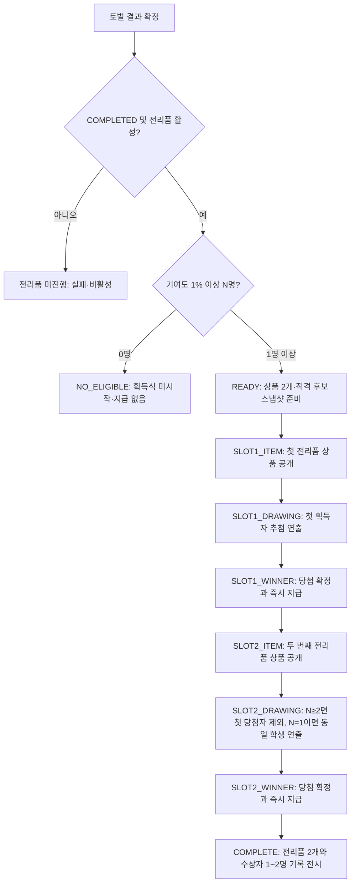

# B.R.A.N.D 2.0 — 레이드 전리품 획득식 시스템 V1.2
## 통합 기획·개발 구현 명세서 V1.2 — 명세 검토·운영 DB 실사 반영 (구현 착수용)

- 문서 상태: **전리품 게임 규칙 확정·구현 설계안 / 아직 미적용**
- 버전: **V1.2 (2026-10-18, 명세 검토 결과·운영 DB 2차 실사·교사 결정 반영 — 변경 내역은 §0.3)**
- 이전 버전: V1.1 (2026-10-17, 중복 완성 편린·0/1명 예외·공용 조각 정책 반영)
- 기준일: **2026-10-18**
- 범위: 전리품 후보 구성 · 서버 가중 추첨 · 자산 원자적 지급 · 교사 운영 설정 · 16:9 레이드 중계 연출 · 기록·복구·검증
- 기존 기능: 레이드 골드 보상/순위 정산을 유지. 전리품 시스템은 별도 경로.
- 기준 리포지토리: `Jamesleekor/brand_2.0`, 기본 브랜치 `main` (2026-10-17 조회)
- 기준 DB: 운영 Supabase 공개 스키마 메타데이터·기존 함수 조회(읽기 전용). 실데이터 변경 없음.

> **용어 주의:** 이 기능은 **'상자 아이템을 학생에게 지급하는 기능'이 아니다.** 보스가 떨어뜨린 전리품의 **내용물을 먼저 공개**하고, 그 내용물을 가져갈 학생을 **그 자리에서 추첨**한다. 제1·제2전리품은 연출 단위이고 보관함에 '미개봉 상자'를 추가하지 않는다.

---

## 0. 결정 기록: 최종 확정 정책과 권장 구현 기본값

### 0.1 사용자와 이미 합의한 사항 (변경 금지)

| 주제 | 확정 규칙 |
|---|---|
| 발동 조건 | 레이드 최종 **토벌 성공**(`COMPLETED`)일 때에만 |
| 실패 처리 | `FAILED`일 때 전리품 추첨/지급 확률 **0%** |
| 전리품 수 | 적격자 ≥1명이라면 **2개**. 적격자 ≥2명은 서로 다른 학생 2명, 적격자 1명은 **그 학생이 전리품 2개 모두 획득** |
| 최소 기여 | 해당 레이드 전체 실제 피해량 중 **1.00% 이상** 기여한 학생만 추첨 대상 |
| 추첨의 공정성 | 기여 순위는 추첨 **가중치**에만 사용. 최소 자격만 충족하면 최하위도 당첨 가능 |
| 최고·최저 가중치 | 동일 추첨에 참가한 최고 기여자 **2**, 최저 기여자 **1** (최대 2배) |
| 1차/2차 중복 | **적격자 2명 이상**이면 제1전리품 당첨자를 2차 대상에서 제외. **적격자 1명**이면 그 한 명에게 2개 모두 지급 |
| 제1전리품 | **GOLD 60% / CRYSTAL 40%**, 당첨자에게 직접 지급 |
| 제2전리품 | **편린 조각 60% / 완성된 편린 40%**, 당첨자에게 직접 지급 |
| 완성 편린의 가치 | **기준 가격 1,000 CRYSTAL 이상**만 후보로 허용 |
| 완성 편린의 상대 확률 | **교사 개별 가중치가 우선**. 교사가 따로 정하지 않은 편린은 기준 가격이 비쌀수록 상대적으로 낮아지도록 설정 |
| 완성 편린 확정 지정 | 교사가 **특정 편린 1종을 확정적으로 나오게** 지정 가능(제2전리품 `FIXED_ITEM`) |
| 한정판 편린 | 영입 방식이 **`이벤트 전용`**(교사 운영 패널 → 편린 운영 → 영입 설정 탭)인 편린 = 한정판. 전리품 후보·확정 지정 모두 **불가** |
| 잠금 후 편린 비활성화 | 설정을 잠근 뒤 편린이 비활성화·가격 변경되어도 **잠긴 내용 그대로 지급** |
| 완성 편린 중복 소유 | 이미 보유한 편린 당첨 시 **잠긴 기준 가격의 90%에 해당하는 CRYSTAL을 대신 직접 지급**. 수상자·상품 재추첨 없음 |
| 적격자 0명 | **전리품 획득식 자체를 진행하지 않으며 전리품 지급 0건** |
| 적격자 1명 | 그 학생이 **제1·제2전리품을 모두 독식**. 상품 공개·발표 흐름은 2회 그대로 유지 |
| 편린 조각 재화 | 기존 원정대의 공용 편린 조각(`expedition_fragment_balances`)과 동일 |
| 교사 통제 | 레이드별 금액·조각 수량·완성 편린 후보 지정, 특정 전리품 사전 지정 지원 |
| 진행 순서 | 토벌 성공 → **1차 상품 공개** → **1차 학생 추첨·발표** → **2차 상품 공개** → **2차 학생 추첨·발표** → 최종 결과 |
| 발표 연출 | 중계화면에서 **교사의 `다음 단계` 버튼**으로 속도 조절. 환호할 시간 확보 |
| 기존 보상 | 기본 골드(성공 100%/실패 30%)와 순위별 추가 골드는 **그대로 유지** |

### 0.2 확정된 게임 규칙과 구별해야 할 **구현 세부 기본값**

1. **완성 편린 선택 가중치(계산 공식 제안):** `sqrt(1000 / 기준가격)` × 교사 개별 가중치(기본 `1.0`). **고가일수록 출현 확률을 낮춘다는 정책은 확정**되었으나 역제곱근이라는 *정확한 함수 형태는 개발 기본안*이다. V1에서 이를 사용하려면 시뮬레이션과 교사 설정 화면에서 명확히 표시한다. **V1.2: 교사 개별 가중치가 우선**이므로 교사가 가중치를 올려 고가 편린이 저가 편린보다 더 잘 나오게 만드는 것(역전)도 **허용**한다. 이때 UI는 막지 않고 안내만 표시한다(§3.5).
2. **90% 금액 정수화(구현 기본안):** `floor(base_price_crystal_snapshot * 90 / 100)` CRYSTAL. 기준 가격은 **해당 레이드에서 잠근 할인 전 기준 가격**이며 추첨 직전 할인·거래가·학생의 과거 구매가를 사용하지 않는다. 크리스탈은 정수 재화이므로 소수점 이하를 내림 처리한다. 정책(90%)과 계산 단위(정수 내림)를 구분한다.
3. **과거 성공 레이드:** 기능 도입 이전 레이드는 소급 지급하지 않고 기본 `전리품 비활성`으로 둔다.
4. **시각·음향:** 아래 연출 시간표는 권장값이며, 교사가 `다음 단계`를 누를 때까지 자동 강제 진행하지 않는다.
5. **보상 금액/편린 조각 수량 범위:** 교사가 설정하는 값이며 본 문서의 숫자 예시는 **실제 기본 지급량을 확정한 것이 아니다.**

**릴리스 차단 정책 미결 3개 해소:** 중복 보유 → 기준가 90% CRYSTAL, 적격 0명 → 진행 없음 / 1명 → 2개 독식, 편린 조각 → 기존 원정 공용 재화. 해당 3개 정책을 이유로 지급 활성화를 막지 않는다. 다만 **DB 제약·권한·실지급 안전성 테스트가 완료되기 전 운영 활성화는 금지**한다.

### 0.3 V1.2 변경 내역 (2026-10-18)

V1.1 검토와 운영 DB 2차 실사(읽기 전용) 결과를 반영했다. V1.1의 다른 규칙은 그대로 유지한다.

| # | 구분 | 변경 내용 | 반영 위치 |
|---|---|---|---|
| 1 | 🔴 DB 실사 | `transactions`의 고유 인덱스 `ux_transactions_raid_reward_once`가 **같은 레이드·학생·재화당 `RAID_REWARD` 1건만** 허용함을 확인. 기본 보상이 이미 그 1건을 쓰므로(3차 레이드: 24명 전원 `RAID_REWARD` GOLD) V1.1 방식으로는 전리품 GOLD가 **항상 실패**. → 거래 출처 enum에 **`RAID_LOOT` 신설(필수)** | §2.1, §3.4, §3.6, §7.3, §9 |
| 2 | 🟠 DB 실사 | `create_transaction`은 **전출 학생**에게 지급하면 오류를 냄 → 추첨 시점에 전출 학생 제외 규칙 추가 | §3.3, §7.3 |
| 3 | 공정성 | **피해량이 같은 학생은 같은 가중치**(순위 자리 평균) | §3.3 |
| 4 | 설계 정리 | 잠금 시점을 하나로 통일: **잠금 = 전투 시작 전 마지막으로 저장한 설정**. ACTIVE 이후 저장 차단. 기존 `teacher_start_raid`는 **수정하지 않음** | §3.5, §3.6, §5.3, §6.1 |
| 5 | 설계 정리 | 버튼 ↔ 단계 ↔ 서버 동작을 **1:1 전이표**로 확정(교사 클릭 총 8회) | §4.2 |
| 6 | 설계 정리 | 중복 요청 방지 키: 라운드의 `request_id` 1칸 → **감사 테이블 전이별 고유 키** + 라운드에는 `settlement_request_id` | §6.4, §6.5 |
| 7 | 설계 정리 | 획득식 진행 중 레이드가 `ARCHIVED`가 되어도 **이미 시작한 획득식은 끝까지 진행 가능**(기존 보관 경로 무수정) | §3.1 |
| 8 | ✅ DB 실사 | 늦게 도착하는 공격: `submit_raid_tap_batch`가 레이드 행을 잠그고 `ACTIVE`가 아니면 공격 거절 → 토벌 확정 후 피해량 불변. **추가 가드 불필요** | §2.1, §7.6 |
| 9 | ✅ DB 실사 | `student_characters.acquired_via`는 제한 없는 text → **CHECK 수정 불필요**. 이벤트 테이블 CHECK만 확장 | §2.1, §7.5 |
| 10 | 교사 결정 | 교사 개별 가중치 우선(역전 허용) + 특정 편린 확정 지정 | §0.1, §3.5, §5.2 |
| 11 | 교사 결정 / DB 실사 | 한정판 = `이벤트 전용`. DB 제약상 크리스탈 영입이 아닌 편린은 기준가가 항상 0 → "크리스탈 영입 + 1,000C 이상" 조건만으로 자동 제외 | §2.1, §3.5 |
| 12 | 교사 결정 | 잠금 후 편린 비활성화·가격 변경 시에도 **잠긴 내용대로 지급** | §3.5, §7.3 |
| 13 | UX | 이름 셔플은 서버 응답 도착까지 계속 돌다가 **당첨자 이름에 천천히 멈춤** / 학생 안내문 축약 | §4.1, §4.2, 부록 A |
| 14 | 교사 결정 | **중계화면 리허설 모드** 신설 — 끝난 성공 레이드의 실제 명단·피해량으로 획득식 전체를 똑같이 돌려보되 **지급·기록·거래 0건** | §4.4, §7.1, §8, §9.2, §10.4 |
| 15 | 교사 결정 | 차원의 문 활동 집계에 `RAID_LOOT` 포함 | §2.1, §9.2 |

**차원의 문 집계 (V1.2 확정 · 구현 단계 정정):** 교사 결정에 따라 **전리품(`RAID_LOOT`)도 레이드 활동으로 보인다.** 구현 전 함수 전체를 다시 읽어 보니, `_dimensional_gate_activity_context_raw`의 `RAID_REWARD` 목록은 "활동으로 세는 목록"이 아니라 **일반 거래 기록에서 빼는 목록**이었다(레이드 보상은 별도 '레이드 정산' 항목으로 이미 보여 주기 때문에 중복 방지용). 따라서 이 목록에 `RAID_LOOT`를 넣으면 오히려 전리품이 활동 기록에서 **사라진다.** → **이 함수는 수정하지 않는다.** 전리품 거래는 `[레이드 전리품] <레이드 이름> · n차 전리품 …` 메모와 함께 일반 활동 기록에 자동으로 나타나고, 완성 편린 획득은 기존 '편린 영입' 항목(`acquired_via='RAID_LOOT'`)으로 나타난다.

---

## 1. 목표 및 비목표

### 1.1 목표

- 참여 기여가 낮아도 충분한 최소 기여를 달성한 학생은 고가 전리품을 얻을 수 있음.
- 적격자가 2명 이상이면 기여 1위의 가중치는 최하위 적격자의 최대 2배에 그치며 **1차·2차 서로 다른 당첨자**를 보장. 적격자가 단 1명일 때만 두 전리품 독식을 허용.
- **상품 공개와 수상자 공개를 반드시 별도 단계**로 분리해 길드원들의 기대와 환호를 유도.
- 교사는 경제 밸런스를 사전 통제하며, 레이드마다 설정을 복제·수정 가능.
- 각 전리품의 돈·조각·편린(또는 중복 편린 90% 크리스탈)은 **서버 측 하나의 트랜잭션에서** 지급·이력 기록·당첨 결과 공개를 함께 완료.
- 네트워크 단절, 새로고침, 더블클릭, 중계 연결 장애에서 중복 지급 또는 재추첨이 일어나지 않음.

### 1.2 비목표(V1)

- 학생 보관함에 미개봉 `레이드 보상 상자` 아이템 추가하지 않음.
- 아이템 재판매, 경매 자동 등록, 재교환, 길드 공동분배 기능 추가하지 않음.
- 원정 상자 개봉 확률·카탈로그를 재사용하지 않음(연출 CSS 일부만 재활용 가능).
- 기존 보스 전투 DPS 수식·공명방벽·치명타·속성 배율 변경하지 않음.
- 현재 골드 기본 보상·순위 보상·미납금 자동 상환 정책 변경하지 않음.

---

## 2. 기존 시스템 실사 (2026-10-17 조회 결과 + 2026-10-18 2차 실사)

### 2.1 실제 운영 DB

| 대상 | 확인 사실 | 설계 시 의미 |
|---|---|---|
| `public.raid_finalize_results(p_raid_id)` | 학생 `total_damage` 기준 순위 확정 후 `raid_settle_rewards` 호출 | 순위가 확정된 **이후** 전리품 진행 |
| `public.raid_settle_rewards` | `COMPLETED`면 기본 100%, `FAILED`면 기본 30%, 순위 보너스와 함께 지급; `raid_reward_settlements` 기록 | 절대 침범·재계산하지 않음 |
| `public.raid_reward_settlements` | `(participant_id)` 및 `(raid_id,student_id)` 고유 인덱스 보유 | 전리품은 **별도** 정산 구조 |
| `public.raid_participants` | `total_damage`, `accepted_tap_count`, `final_rank`, `student_id` 기록 | 적격자 추출·가중치 계산의 유일한 원천 |
| `public.raids` | `status`, `classroom_id`, `reward_config`, `metadata` 보유 | 토벌 성공 여부·학급 구분·활성화 플래그 |
| `public.character_recruitment_offers` | `base_price_crystal`, `classroom_id`, `is_active`, `acquisition_mode` | 가격 1,000 이상 후보 필터, 가격 가중치 |
| `public.characters` | 편린 UID, 이름, 이미지 URL, 활성 상태 | 실제 편린 표시·이미지 렌더링 |
| `public.student_characters` | `(student_id,character_id)` 고유, `is_owned`, `acquired_via`. **(V1.2 실사)** `acquired_via`는 제한 없는 `text`(CHECK 없음) | 완성된 편린 보유 기록. `RAID_LOOT` 값 저장에 제약 수정 불필요 |
| `public.character_acquisition_events` | `event_type` 체크 허용: `RECRUIT/TEACHER_GRANT/RESTORE/REVOKE/MIGRATION` | **`RAID_LOOT` 기록을 위해 제약 확장 필요** |
| `public.expedition_fragment_balances` | 학생별 편린 조각 잔액 | 제2전리품 조각 지급 후보 장부 |
| `public.expedition_fragment_ledger` | `REWARD`는 `source_run_id` 필수; 허용 이벤트 4종 | **기존 `REWARD` 유형에 원정 ID 없이 직접 넣을 수 없음** |
| `public._expedition_adjust_fragments` | 이벤트 `REWARD/RESTORE/TEACHER_ADJUST/MIGRATION`만 허용 | **`RAID_LOOT` 전용 경로·체크 제약 추가**가 정식 방식 |
| `public.create_transaction(...)` | `GOLD`/`CRYSTAL` 지원, `RAID_REWARD` 거래 출처 enum 존재. **(V1.2 실사)** 전출 학생(`students.transferred_at IS NOT NULL`)에게는 오류(P0002). 양수 GOLD 지급 시 미납금 자동 징수 실행 | 재화 지급은 기존 지갑·거래 함수를 재사용. **함수 자체는 수정하지 않음** |
| `transactions` 고유 인덱스 `ux_transactions_raid_reward_once` **(V1.2 실사)** | `(student_id, source_id, value_token) WHERE source_type='RAID_REWARD'` — 학생·레이드·재화당 **1건만** 허용. 3차 레이드(62)는 24명 전원 `RAID_REWARD` GOLD 보유 | **전리품은 `RAID_REWARD`를 쓰면 안 됨.** 새 enum 값 `RAID_LOOT` 필수(§3.4) |
| `submit_raid_tap_batch` / 트리거 `trg_raid_refresh_terminal_results_after_attack_batch` **(V1.2 실사)** | 공격 함수가 레이드 행을 `FOR UPDATE NOWAIT`로 잠그고 `status<>'ACTIVE'`면 공격 거절. 트리거는 보스를 쓰러뜨린 그 배치에서만 순위 확정 실행 | 토벌 확정 후 `total_damage` 불변 → PREPARE 추가 가드 불필요 |
| `raid_finalize_results` 동률 처리 **(V1.2 실사)** | `final_rank`는 `total_damage DESC, last_attack_at ASC, student_id ASC` 순 | `final_rank`는 동점자도 순위가 갈림 → **가중치 계산에 쓰지 않음**(§3.3) |
| `character_recruitment_offers` 제약 **(V1.2 실사)** | `acquisition_mode ∈ CRYSTAL/FREE/TEACHER_ONLY/EVENT_ONLY/UNAVAILABLE`. **CRYSTAL이 아니면 `base_price_crystal=0` 강제** | "CRYSTAL + 1,000C 이상"이면 이벤트 전용·교사 지급·무료가 자동 제외 |
| `_dimensional_gate_activity_context_raw` **(V1.2 실사)** | 일반 거래 기록에서 **제외**하는 출처 목록에 `RAID_REWARD` 포함(레이드는 별도 정산 항목으로 표시) | **정정: 수정 불필요.** `RAID_LOOT`는 목록에 없으므로 일반 활동 기록에 자동 노출(§0.3) |
| `public.teacher_grant_character` | 완성 편린 등록은 하지만 `TEACHER_GRANT` 출처로 기록 | 전리품에서는 **별도 `RAID_LOOT` 출처 함수** 필요 |
| `public.teacher_delete_raid_record` | 기록 삭제 시 기존 지급된 골드 환급/회수 수행하지 않음. **(V1.2 실사)** 마지막에 `DELETE FROM public.raids`를 직접 실행 | 전리품 지급 이후 삭제 경로의 감사 보존·차단 필수. 새 FK가 `RESTRICT`이면 원시 FK 오류가 나므로 **사전 확인 + 안내 문구** 필요(§6.6) |

**실사한 제3차 레이드(ID 62):** 24명 `raid_participants`, 총 피해량 `7,996,445`, 실제 피해량 기준 1% 이상 **20명**. 이전 대화에서 육안으로 확인한 `19명`과 차이가 있으므로 UI에 반올림된 기여도 숫자를 기준으로 삼으면 안 된다. **원시 정수 피해량으로만** 판단.

**실사한 편린 상품:** 활성 기준 가격 1,000 CRYSTAL 이상인 영입 상품 **36종**(조사 시점). `EVENT_ONLY` 상품 4건은 가격 0이므로 최소 가격 조건 미달; 자동 후보에서 제외.

**현 상태:** `raid_loot_*` 전용 테이블·RPC는 조회 범위에서 발견되지 않았고, 저장소에도 해당 중계·추첨 UI는 없음. 구현 미적용. (현 레이드 **속성 배율** 기능은 별개.)

### 2.2 연결할 기존 클라이언트 파일

- `src/features/teacher/raid/RaidControlPage.tsx`: 레이드 초안/설정 편집, 레이드 상태·전투 시작/종료
- `src/features/teacher/raid/RaidV15ConfigPanel.tsx`: 현재 구성 탭 `전투 기믹`, `패턴 에디터`, `오디오 프로필`; 여기 **`🎁 전리품 설정`** 탭 추가 권장
- `src/features/teacher/raid/RaidBroadcastPage.tsx`: 16:9 중계 (`refetchInterval: 1000`), 현재 완료·실패 오버레이 존재
- `src/features/teacher/raid/RaidBroadcastAudio.ts`: 기존 성공 BGM 및 SFX 채널 재사용
- `src/lib/rpc/raid_admin_rpc.ts`, `src/lib/rpc/raid_v15_admin_rpc.ts`: 교사 RPC 타입·호출
- `src/features/raid/RaidResultModal.tsx` & `src/lib/rpc/raid_student_rpc.ts`: 학생 결과 페이지에서 공개된 전리품 표시
- `src/features/character/expedition/ExpeditionBoxOpeningModal.tsx`: **시각 연출만 참조**, 기능/DB 로직 재사용 금지
- 추천 신규 파일: `src/features/teacher/raid/RaidLootConfigPanel.tsx`, `RaidLootCeremonyOverlay.tsx`, `raidLootCeremony.css`, `src/lib/rpc/raid_loot_rpc.ts`

---

## 3. 핵심 게임 규칙 — 단일 진실 원천

### 3.1 성공 판정

- 최종 상태가 **`COMPLETED`**인 레이드만 전리품 지급 가능.
- `FAILED`, `ACTIVE`, `PAUSED`, `LOBBY_OPEN`, `DRAFT`에서는 생성/추첨/지급 불가.
- `ARCHIVED`는 성공/실패 의미를 보존하지 못할 수 있으므로 **최종 원본 상태 스냅샷이 `COMPLETED`로 증명된 획득식만 재열람** 허용. 신규 지급 금지.
- **(V1.2) 진행 중 보관 예외:** 획득식 행(`raid_loot_ceremonies`, `raid_original_status='COMPLETED'`)이 **이미 생성된 뒤** 레이드가 `ARCHIVED`로 바뀌면, 그 획득식은 **남은 단계를 끝까지 진행·지급할 수 있다.** 금지되는 것은 `ARCHIVED` 레이드에서 **새 획득식을 시작(PREPARE)**하는 것뿐이다. 이렇게 하면 1차만 지급된 채 2차가 영원히 막히는 일이 없고, 기존 보관 경로는 수정하지 않는다.
- `raid_loot_configs.enabled = false`인 레이드는 기능 자체를 건너뜀. 기존 레이드·과거 성공 레이드는 모두 기본 비활성.
- 기존 `reward_config.rewards_enabled`와 **전리품 활성화 여부는 별개**. UI에서 명확히 구분.

### 3.2 딜 기여도와 적격 판정 (소수점 반올림 금지)

```sql
WITH totals AS (
  SELECT COALESCE(SUM(total_damage),0)::numeric AS total_damage
  FROM public.raid_participants
  WHERE raid_id = :raid_id
)
SELECT rp.id AS participant_id, rp.student_id, rp.total_damage,
       rp.final_rank, totals.total_damage AS raid_total_damage
FROM public.raid_participants rp CROSS JOIN totals
JOIN public.students s ON s.id = rp.student_id          -- V1.2: 전출 학생 제외용
WHERE rp.raid_id = :raid_id
  AND s.transferred_at IS NULL                          -- V1.2
  AND rp.accepted_tap_count > 0
  AND rp.final_rank IS NOT NULL
  AND totals.total_damage > 0
  AND rp.total_damage::numeric * 100 >= totals.total_damage
ORDER BY rp.total_damage DESC, rp.final_rank ASC, rp.student_id ASC;
```

- 분모: 레이드 참가자 **전체**의 `total_damage` 합계(공격 없는 학생도 분모 0으로만 기여).
- 분자: 개인의 `total_damage`. 보스 HP에 실제 반영된 피해를 기준으로 하며 `objective_damage`처럼 별도 기믹 지표는 포함하지 않음.
- `100 × 개인 피해량 >= 전체 피해량`이면 적격. 0.999...%는 제외, 정확히 1.000...%는 포함.
- 최초 추첨 대상자·순위·비율·가중치 정보는 `PREPARE` 시점에 **불변 JSON/테이블로 스냅샷**. 나중에 학생 이름·장착 편린 변경이나 DB 갱신이 추첨을 바꾸지 못함.
- **(V1.2) 전출 학생:** `PREPARE` 시점에 `students.transferred_at IS NOT NULL`인 학생은 적격자에서 제외한다(분모인 전체 피해량에는 그대로 포함). 1% 판정은 제외 전 전체 피해량 기준으로 한다.
- **(V1.2) 피해량 확정 시점:** DB 실사 결과 토벌 확정(`COMPLETED`) 이후에는 공격이 거절되어 `total_damage`가 바뀌지 않는다. 따라서 `PREPARE`에 "늦은 공격 대기" 가드는 두지 않는다.

### 3.3 전리품 2개 확정 및 1:2 가중 추첨

- `N >= 2`: **중복 없는 2명**에게 각 1개. `N = 1`: 유일 적격자 1명이 **제1·제2전리품 2개 모두 획득**. `N = 0`: 획득식을 시작하지 않고 상품 선정·지급도 수행하지 않음.
- 기여도로 정렬한 적격자 `rank=1..N`에 대해:

```text
weight(rank,N) = 2.0 - (rank - 1) / (N - 1)       [N >= 2]
rank 1 → 2.0, rank N → 1.0
```

- 추첨은 이 **가중치 비율로 서버에서만** 무작위 수행. 1위 확률이 2배로 확정되었다는 뜻이 아니라 같은 **추첨에서 사용할 상대 가중치**의 2배라는 뜻.
- `N>=2`: **1차** 후보 전체 N명. **2차**는 1차 수상자를 제외한 N−1명으로 재정렬·가중치 재산출. `N=2`이면 두 번째 학생을 확률 100%로 선정.
- `N=1`: 두 차례 모두 같은 학생이 확률 100%로 선정되며 **가중치 공식 `N−1` 분모를 계산하지 않음**. `N=0`: `NO_ELIGIBLE` 상태를 교사 조회 응답으로만 표시하며 **ceremony / round / 거래 기록을 생성하지 않음**.
- `N=1`에서도 두 상품의 종류·수량·편린 후보 추첨은 **서로 독립**이며 60:40 설정을 그대로 적용. 당첨자만 동일하고 공개→추첨→발표 연출은 두 번 유지.
- 기존 `final_rank`는 동률 정렬·UI 보조용으로만 쓰고, 기여도 비교의 원시 `total_damage`를 기준으로 순위를 산출. 동률은 `final_rank`/`student_id`로 안정 정렬.
- **(V1.2) 동점자 가중치 — 같은 피해량은 같은 가중치:** 위 안정 정렬은 **화면 표시 순서**에만 쓴다. 가중치는 `total_damage`가 같은 학생들이 차지한 순위 자리들의 `weight(rank,N)` **평균값**을 모두에게 똑같이 준다. (`final_rank`는 `last_attack_at`으로 동점자를 가르므로 가중치 계산에 쓰지 않는다.)

```text
예) N=19, 2위·3위가 동점 → 두 학생 모두 (weight(2,19)+weight(3,19))/2 = (1.944+1.889)/2 = 1.917
예) N=2, 두 학생 동점 → 두 학생 모두 (2.0+1.0)/2 = 1.5 → 1차 추첨 50:50
```

  - 동점 평균을 써도 최고 가중치 ≤ 2.0, 최저 가중치 ≥ 1.0이므로 "최대 2배" 규칙은 그대로 지켜진다.
  - 2차 추첨에서 N−1명으로 가중치를 다시 계산할 때도 같은 동점 규칙을 적용한다.
- **(V1.2) 추첨 시점 전출 재확인:** `PREPARE` 이후 당첨자 확정 전에 전출 처리된 학생은 그 추첨 후보에서 빼고, 남은 후보로 가중치를 다시 계산한다(2차 재계산과 같은 방식). 추첨 가능한 후보가 0명이 되면 그 슬롯은 지급 없이 `VOID`로 끝나고 교사에게 사유를 표시한다(§6.4). 매우 드문 경우이며 재추첨으로 다른 상품을 주지 않는다.
- **주의:** N>=2에서 두 명을 확정 선정할 때 개별 최종 당첨 확률은 3~6%로 제한할 수 없다. 예: N=19라면 균등 추첨 평균 당첨률은 2/19 ≈ 10.53%.
- 서버 난수만 사용. 클라이언트 `Math.random()`은 당첨자 연출용 이름 셔플에만 사용하며 실제 결과를 선택할 권한 없음.

### 3.4 제1전리품: GOLD 또는 CRYSTAL

| 항목 | 자동 선택 | 교사 개입 |
|---|---|---|
| 상품 종류 | `GOLD=6000bp`, `CRYSTAL=4000bp` | `AUTO` / `FIXED_KIND` / `FIXED_ITEM` |
| 수량 | `{min,max,step}` 정수 범위에서 균등 추첨 | 범위, 단계, 고정량 설정 가능 |
| 지급 | `create_transaction`을 통해 학생 지갑에 직접 지급 | 지급 시점·금액·대상은 서버 검증 |

- 금액·수량 **기본 수치를 사용자가 아직 확정하지 않았다.** 이전 800~2,000 GOLD 및 300~800 CRYSTAL은 **단순 UI 예시**이지 확정 설정이 아님.
- `FIXED_KIND`: 종류를 교사가 지정하지만 수량은 범위 추첨 가능.
- `FIXED_ITEM`: 종류와 수량 모두 고정. 이 경우 `60:40`은 추첨하지 않음(교사 지정이 우선).
- `min>0`, `max>=min`, `step>=1` 및 `(max-min)%step=0` 검증. 상한은 경제 정책에 맞춰 별도 상수로 관리.
- `GOLD`의 기존 미납금·채무 자동 상환 연동은 `create_transaction` 기본 동작을 따름. UI는 **전리품 총 지급액**과 **실제 지갑 증가액**을 서로 혼동하지 않도록 필요 시 구분.
- **(V1.2 필수) 거래 출처는 `RAID_LOOT`:** 기존 `RAID_REWARD`는 고유 인덱스 `ux_transactions_raid_reward_once` 때문에 학생·레이드·재화당 1건만 가능하고, 그 1건은 기본 보상이 이미 사용한다. 따라서 전리품 지급은 모두 새 enum 값으로 기록한다.

```text
create_transaction(student_id, 'GOLD'|'CRYSTAL', amount,
                   'RAID_LOOT', raid_loot_rounds.id, 0,
                   '[레이드 전리품 #n] raid=<raid_id> ...')
```

  - `source_id`는 **라운드 ID**(`raid_loot_rounds.id`)를 쓴다. 슬롯마다 ID가 달라서, 적격자 1명이 1차 CRYSTAL과 2차 중복 편린 CRYSTAL을 함께 받아도 충돌하지 않는다. 레이드 ID는 메모와 라운드 행으로 추적한다.
  - 안전장치로 새 고유 인덱스 `ux_transactions_raid_loot_once (source_id) WHERE source_type='RAID_LOOT'`를 추가한다. 라운드 1개당 거래는 정확히 1건만 생길 수 있다.
  - `ALTER TYPE public.transaction_source_type ADD VALUE 'RAID_LOOT'`는 **별도 마이그레이션으로 먼저 적용**한다. PostgreSQL은 새 enum 값을 추가한 트랜잭션 안에서 바로 사용할 수 없기 때문이다(§9.3).
  - 기존 `RAID_REWARD` 인덱스·기본 보상 함수·`create_transaction` 본문은 **수정하지 않는다.**
  - 거래 내역 화면 등 출처 라벨을 표시하는 프런트 코드에 `RAID_LOOT` 라벨(예: "레이드 전리품")을 추가한다.

### 3.5 제2전리품: 편린 조각 또는 완성 편린

| 항목 | 자동 선택 | 교사 개입 |
|---|---|---|
| 상품 종류 | `FRAGMENTS=6000bp`, `CHARACTER=4000bp` | `AUTO` / `FIXED_KIND` / `FIXED_ITEM` |
| 조각 수량 | `{min,max,step}` 정수 범위 | 범위·고정 수량 |
| 완성 편린 | 교사가 지정한 **후보 풀 중 가격가중 추첨** | 후보 체크/제외, 개별 가중치, 1종 강제 지정 |
| 지급 | 공용 편린 조각 장부 또는 `student_characters` 직접 반영 | 서버 지급 + 이력 + 결과를 원자적으로 기록 |

**완성 편린 후보 자격(교사가 체크하더라도 서버 재검사)**

1. `characters.is_active=true`, `character_recruitment_offers.is_active=true`.
2. **해당 레이드 학급의** `character_recruitment_offers` 행 사용. 다른 학급 상품 혼입 금지.
3. `base_price_crystal >= 1000` (할인된 판매가가 아니라 **기준 가격**).
4. `acquisition_mode='CRYSTAL'`을 기본 허용. `EVENT_ONLY`, 가격 0, 미설정 가격 후보는 자동 제외.
5. 이미 후보 목록에 들어있어도 **레이드 시작 시 보상 풀 스냅샷 생성 단계에서 재검사**. 가격 변동 후에도 과거 전리품 확률이 바뀌지 않도록 저장.
   - **(V1.2) 재검사·스냅샷 시점 = 설정 저장 시점:** 별도의 "전투 시작 시 잠금"을 만들지 않는다. `teacher_save_raid_loot_config`가 저장할 때 1~4번을 검사하고, 그때의 기준가·이름·이미지를 `raid_loot_character_pool`에 기록한다. 레이드가 `ACTIVE`가 된 뒤에는 저장 자체가 거절되므로 **전투 시작 전 마지막 저장 값이 곧 잠긴 값**이다. 기존 `teacher_start_raid`는 수정하지 않는다.
   - 저장 후 전투 시작 전에 영입 설정에서 가격·활성 상태가 바뀌면, 전리품 설정 패널에 "영입 설정이 바뀌었습니다. 다시 저장하세요" 경고를 띄운다(차단하지 않음).
   - **(V1.2) 잠근 뒤의 변경은 무시하고 그대로 지급:** `PREPARE`와 당첨 지급 단계에서는 1~4번을 **다시 검사하지 않는다.** 잠금 후 편린이 비활성화되거나 가격이 바뀌어도, 잠긴 기준가·확률·후보 그대로 추첨하고 지급한다.
6. **(V1.2 확정) 한정판 = 영입 방식 `이벤트 전용`(`EVENT_ONLY`)** 편린이다(교사 운영 패널 → 편린 운영 → 영입 설정 탭에서 지정). DB 제약상 `CRYSTAL`이 아닌 모든 영입 방식(`EVENT_ONLY`, `TEACHER_ONLY`, `FREE`, `UNAVAILABLE`)은 기준가가 **항상 0**이므로, 3·4번 조건만으로 자동 제외된다. 무분별한 자동 전체선택은 금지하고, 조건을 통과하지 못한 편린은 **후보 추가·확정 지정 모두 불허**한다.

**가격가중치 — 권장안(최종 수치 승인 필요)**

```text
weight(character) = sqrt(1000 / base_price_crystal) × manual_factor
manual_factor 기본 1.0 (설정 가능 범위 예: 0.25 ~ 4.0)
P(character_i) = weight_i / SUM(all selected candidate weights)
```

| 기준 가격 | `manual_factor=1` 상대 가중치 |
|---:|---:|
| 1,000 C | 1.000 |
| 2,000 C | 0.707 |
| 4,000 C | 0.500 |
| 6,000 C | 0.408 |

- 같은 후보 풀에서 고가 편린이 덜 나오지만 **0%는 아님**. 각 항목 UI에 최종 상대 확률 표시.
- **(V1.2) 교사 개별 가중치 우선:** `manual_factor`를 바꾸지 않은 편린(기본 1.0)은 가격 규칙대로 비쌀수록 덜 나온다. 교사가 `manual_factor`를 바꾸면 **그 값을 그대로 적용**하며, 그 결과 고가 편린이 저가 편린보다 더 잘 나오는 역전도 허용한다. 예: 6,000C 편린 ×4.0 → 1.633, 1,000C 편린 ×1.0 → 1.000. 역전이 생기면 패널에 "가격보다 교사 가중치가 우선 적용 중" 안내를 표시한다(저장은 막지 않음).
- **(V1.2) 특정 편린 확정 지정:** 제2전리품 `FIXED_ITEM` + `fixed_character_id`로 지정하면 **제2전리품은 반드시 그 편린**이 된다(60:40 추첨과 가격가중 추첨 모두 생략, 당첨 학생은 여전히 가중 추첨). 확정 지정할 편린도 위 1~6번 자격을 통과해야 한다. 패널의 후보 목록 각 줄에 `이 편린 확정` 버튼을 둔다.
- `CHARACTER` 모드에 후보가 0개면 `전리품 설정 저장은 가능해도 활성화/시작 불가`. **자동으로 조각으로 바꾸거나 다른 상품 추가 금지**.
- 후보 가격과 표시 이름/이미지/확률을 `PREPARE` 때 고정(히스토리 재현). **(V1.2)** 이때 값은 실시간 영입 설정이 아니라 **잠긴 설정(마지막 저장 값)에서 복사**한다.

### 3.6 완성 편린 중복 소유 — **기준가 90% CRYSTAL 대체 지급(확정)**

당첨 학생이 대상 편린을 이미 `student_characters.is_owned=true`로 보유한 경우, 그 학생의 **당첨 자격·선정 결과·원래 공개한 완성 편린은 그대로 유지**하며 새 편린을 중복 등록하지 않는다. 대신 **그 편린의 기준 가격 90%만큼 CRYSTAL을 직접 지급**한다. 편린 조각으로 전환하거나 학생을 재추첨하지 않는다.

**확정 처리 규칙 및 구현 계약**

- `duplicate_policy='CONVERT_TO_CRYSTAL_90'` **고정**. `duplicate_fragment_quantity` 및 조각 전환 설정은 V1에서 제거.
- 지급 금액(정수): `floor(locked_base_price_crystal * 0.90)` CRYSTAL. 정확한 정수 산식으로는 `locked_base_price_crystal * 90 / 100`의 정수 내림. 예: 1,000C → **900C** / 2,500C → **2,250C** / 4,999C → **4,499C** / 6,000C → **5,400C**.
- 가격 기준은 후보를 **전투 시작 시 잠근** `base_price_crystal` 스냅샷 값(**V1.2: 전투 시작 전 마지막으로 저장한 전리품 설정의 값**, §3.5 5번). 할인율·실제 결제 금액·운영 중 가격 조정은 무시한다. `reward_snapshot.base_price_crystal`과 `conversion_rate_bp=9000` 저장.
- 중복 여부는 **당첨자를 확정하고 지급하는 바로 그 트랜잭션에서** 잠금/유일 키를 통해 판정한다. 상품 공개 시점 보유 여부를 추측해서 선결정하지 않음. 구매와 동시 진행 시 중복 보유 생성 없이 직렬화되어야 함.
- 중복이면 `create_transaction(..., 'CRYSTAL', converted_amount, 'RAID_LOOT', raid_loot_rounds.id, 0, '[레이드 전리품 #2 / 중복 완성 편린 90% 대체 지급] raid=<raid_id> ...')`를 호출하고(**V1.2: `RAID_REWARD` → `RAID_LOOT`, source_id는 라운드 ID**, §3.4) `transaction_id`를 증빙으로 보관. 기존 `student_characters` 보유 기록은 건드리지 않고 신규 획득 이벤트도 만들지 않음.
- 발표 카드: **당초 공개한 편린 이미지·이름**을 유지한 채 수상자 발표 후 `이미 보유 중 → 90% 크리스탈 보상 지급 (X C)`를 추가 표시. 사용자에게 실제 지급 상품과 원래 전리품을 혼동시키지 않음. 학생 결과 화면에도 동일 표기.
- `raid_loot_rounds.reward_kind='CHARACTER'`, `delivered_kind='CRYSTAL'`, `delivered_amount=X`, `delivered_character_id=NULL`, `transaction_id`가 정확히 한 건을 가리킨다. 지급 결과 감사 이벤트에 `original_character_id`, `snapshot_price_crystal`, `conversion_rate_bp=9000` 저장.

> **주의:** 90% 지급은 편린을 다시 구매하는 환불이 아니라 **중복 당첨에 대한 대체 보상**이다. 기존 학생의 자산에서 크리스탈을 빼거나 편린을 회수하면 안 된다.

---

## 4. 진행 연출: 중계 화면에서 교사가 직접 다음 단계

### 4.1 상태 기계 — 서버가 관리하는 단일 진실



**상태 전이 원칙**

- `READY`는 교사가 **전리품 획득식 시작**을 눌러 적격자 `N>=1`인 경우에만 생성. 적격자 `N=0`이면 **획득식 행을 만들지 않고** 관리자 조회에 `NO_ELIGIBLE` 안내만 반환. 레이드 성공 직후 자동으로 지갑에 지급하지 않음.
- `SLOT1_ITEM`/`SLOT2_ITEM`: 해당 상품 종류·수량·캐릭터를 **서버에서 1회 결정**, 저장 후 학생/중계에 공개. 당첨자 정보는 **노출하지 않음**.
- `SLOT1_DRAWING`/`SLOT2_DRAWING`: 이름 셔플·룰렛 애니메이션. 이 단계에는 **당첨자도 지급도 미확정**이며 클라이언트 셔플은 연출뿐. 단 `N=1`이라면 두 번 모두 같은 1명을 보여주는 **확정 당첨 연출**을 제공하고 실제 서버 지급만 확정 단계에서 실행.
- **(V1.2) 셔플 멈춤 방식:** 교사가 `당첨자 확정`을 누르면 셔플은 멈추지 않고 **서버 응답이 올 때까지 계속 돈다.** 응답(당첨자)이 도착하면 그때부터 1.5~2.5초 동안 점점 느려지다가 **당첨자 이름에 정확히 멈춘다.** 응답이 3초 넘게 늦으면 셔플 아래에 `최종 결과 확인 중…`을 작게 표시한다. 셔플이 멈출 이름은 항상 서버 응답의 당첨자이며, 클라이언트가 먼저 멈출 이름을 고르지 않는다.
- `SLOT1_WINNER`/`SLOT2_WINNER`: 애니메이션 종료 후 교사 버튼(또는 확정 요청)으로 서버가 가중 추첨 → 지급 → 기록 → 공개를 **하나의 DB 트랜잭션**에서 처리. 결과 통신이 늦으면 `최종 결과 확인 중…`으로 기다림.
- `COMPLETE`: 두 지급 결과 존재 검증 뒤 마무리. `뒤로 보기`는 저장 결과 **재표시만**, 상태를 되돌리거나 재추첨하지 않음.
- 교사의 클릭을 기준으로 수동 진행; 오디오·조명·카운트다운은 선택적 자동 연출. 이름 셔플 속도는 3~5초 권장, **강제 다음 단계 자동 전환 금지**.
- 클릭 더블 전송·재접속은 항상 **같은 결과** 반환. 동시 중계 브라우저 두 개 중 한 개만 전이 성공; 나머지는 변경된 최신 상태 반환.
- 대미지/순위가 확정된 뒤 `PREPARE`에서 스냅샷 동결. 이후 학생 이름 변경이 현재 발표 이름과 당첨 가중치를 바꾸지 않음.

### 4.2 교사 중계 화면 연출 타임라인 (권장)

#### 4.2.1 (V1.2) 버튼 ↔ 단계 전이표 — 개발 기준

아래 표가 **유일한 기준**이다. 교사 버튼 1번 클릭 = 서버 전이 1번이며, 총 **8번** 클릭으로 끝난다. 각 버튼은 해당 RPC가 `p_expected_status`로 **현재 단계**를 함께 보낸다.

| # | 현재 단계 | 교사 버튼 | 호출 RPC | 서버가 하는 일 | 다음 단계 |
|---|---|---|---|---|---|
| 1 | (레이드 `COMPLETED`, 획득식 없음) | `전리품 획득식 시작` | `teacher_prepare_raid_loot` | 적격 검증·적격자/설정 스냅샷 생성. N=0이면 `NO_ELIGIBLE` 반환(행 생성 없음) | `READY` |
| 2 | `READY` | `1차 전리품 공개` | `teacher_advance_raid_loot` | 1차 상품 종류·수량 결정·저장 | `SLOT1_ITEM` |
| 3 | `SLOT1_ITEM` | `1차 획득자 추첨 시작` | `teacher_advance_raid_loot` | 상태만 변경(지급 없음) | `SLOT1_DRAWING` |
| 4 | `SLOT1_DRAWING` | `당첨자 확정` | `teacher_advance_raid_loot` | 당첨자 가중 추첨 + 지급 + 기록 (한 트랜잭션) | `SLOT1_WINNER` |
| 5 | `SLOT1_WINNER` | `2차 전리품 공개` | `teacher_advance_raid_loot` | 2차 상품 종류·수량/편린 결정·저장 | `SLOT2_ITEM` |
| 6 | `SLOT2_ITEM` | `2차 획득자 추첨 시작` | `teacher_advance_raid_loot` | 상태만 변경(지급 없음) | `SLOT2_DRAWING` |
| 7 | `SLOT2_DRAWING` | `당첨자 확정` | `teacher_advance_raid_loot` | 당첨자 추첨(N≥2는 1차 당첨자 제외) + 지급(중복 편린이면 90% 크리스탈) + 기록 | `SLOT2_WINNER` |
| 8 | `SLOT2_WINNER` | `최종 결과` | `teacher_advance_raid_loot` | 두 슬롯 지급 완료(또는 `VOID`) 확인, 완료 표시 | `COMPLETE` |

- `COMPLETE`에서는 `결과 기록 보기`만 있으며 서버 전이는 없다.
- 버튼은 앞 요청이 성공 응답을 받은 뒤에만 다음 이름으로 바뀐다. 같은 버튼을 두 번 눌러도 서버는 같은 `request_id`로 같은 결과만 돌려준다.

#### 4.2.2 화면 연출 (권장)

> 아래 표의 `서버 side-effect` 열은 **그 화면으로 들어오는 순간** 이미 끝난 서버 동작을 뜻한다. 버튼과 서버 동작의 정확한 대응은 §4.2.1을 따른다.

| 단계 | 16:9 투사 화면 | 우측/하단 교사 버튼 | 서버 side-effect |
|---|---|---|---|
| 0 토벌 성공 | 보스 HP 0 → `BOSS DEFEATED` → 축하 BGM | `전리품 획득식 시작` | (없음) |
| 0-1 획득식 준비 (`READY`) | "보스가 전리품 2개를 떨어뜨렸다!" 타이틀, 닫힌 상자 2개 | `1차 전리품 공개` | 준비·적격 검증·스냅샷 |
| 1 1차 상품 공개 | 첫 상자 등장 → GOLD 또는 CRYSTAL, **정확한 수량 크게 표시** | `1차 획득자 추첨 시작` | 상품 draw once 저장 |
| 2 1차 추첨 | 적격자 이름/아바타 셔플 → 긴장감 | `당첨자 확정` (또는 연출 끝나면 활성) | 아직 지급 없음 |
| 3 1차 당첨 발표 | 당첨자 이름/캐릭터 확대, 색종이·SFX, 잠깐 멈춤 | `두 번째 전리품 공개` | 가중 추첨+재화 지급+이력 |
| 4 2차 상품 공개 | 조각이면 수량 / 편린 완제품이면 이름·**캐릭터 공식 이미지** 공개 | `2차 획득자 추첨 시작` | 상품 draw once 저장 |
| 5 2차 추첨 | `N>=2`: **1차 당첨자 제외** 후 셔플 / `N=1`: **동일 학생 2연속 당첨** 확정 연출 | `당첨자 확정` | 아직 지급 없음 |
| 6 2차 당첨 발표 | 수상자·지급 완료 표시. 이미 보유한 완성 편린이면 **기준가 90% 크리스탈 대체 지급**을 강조 | `최종 결과` | 편린/조각 또는 중복 크리스탈 대체 지급 원자 처리 |
| 7 완료 | `N>=2`: A학생 / B학생, `N=1`: **A학생 두 전리품 독식** 결과 전시 | `결과 기록 보기` | 완료 플래그만 |

**UX 주의:** 완료 오버레이(`BroadcastStatusOverlay`)보다 전리품 애니메이션 레이어가 위에 떠야 함. 오버레이가 투명하지 않아 가리는 문제 방지. 교사 컨트롤은 전체화면에서도 키보드/클릭 접근 가능하며, 학생에게 보이는 화면을 가리지 않는 작고 고정된 위치로 배치. 발표용 화면과 조작용 패널을 분리하는 '교사 컨트롤 사이드패널'도 선택지.

### 4.3 사운드·성능·접근성

- 전투 성공 BGM(`RaidBroadcastAudioEngine.syncRaidState('COMPLETED')`)은 그대로 사용.
- **상자 등장 / 상품 공개 / 이름 셔플 / 수상자 확정** 4종의 SFX는 별도 선택 URL로 확장하되, 미등록 시 짧은 합성음 또는 무음 대체. 기존 오디오 설정값을 덮지 않는다.
- 시각 자산은 기존 이미지·영상 CDN 사용 가능. 그래픽은 16:9, 데스크톱 1920×1080 투사 우선, 1366×768·모바일 반응형.
- `prefers-reduced-motion`이면 회전·반짝임을 제한하고 이름 셔플 즉시 완료 가능. 플래시 고빈도 반복 금지.
- 로딩 실패·이미지 404일 때 텍스트 카드로 폴백. 이미지 복제/다운로드 강제 없음.
- `next` 버튼은 **현재 단계 서버 요청 성공 후** 활성. 서버 장애 시 재시도, 이미 발표한 상품·당첨자 유지.
- 시청 학생에게 당첨자·전리품 데이터가 **공개 단계 이전**에 API, React Query, 실시간 이벤트, 레이드 결과 응답을 통해 노출되지 않도록 **서버 응답 필터링**.

### 4.4 (V1.2 신설) 리허설 모드 — 지급 없이 중계 연출 전체 미리보기

**왜 필요한가:** 획득식 연출은 교사 중계화면에서만 진행된다. 그런데 실제 진행은 레이드를 성공시켜야 하고, 한 번 하면 진짜로 지급된다. 테스트 계정을 매번 레이드에 참여시킬 수도 없다. 리허설 모드는 **이미 끝난 성공 레이드의 실제 데이터로 획득식을 몇 번이든 돌려보는** 기능이다.

**핵심 원칙 (절대 규칙)**

1. **DB 쓰기 0건.** 리허설은 지갑·거래·편린 보유·조각 잔액·획득식·라운드·감사 테이블 어디에도 행을 만들거나 바꾸지 않는다. 읽기 전용 RPC 하나만 쓴다.
2. **실제 진행 RPC 호출 금지.** 리허설 화면은 `teacher_prepare_raid_loot`·`teacher_advance_raid_loot`를 **절대 호출하지 않는다.** 코드상 별도 컴포넌트 상태(`mode: 'REHEARSAL'`)로 분리하고, 실제 진행 버튼과 같은 핸들러를 공유하지 않는다.
3. **추첨 계산은 실제와 같은 함수.** 적격 판정·동점 평균 가중치·전출 제외·60:40·가격가중·1:2 가중 추첨·중복 편린 90% 계산은 실제 진행과 **같은 내부 계산 함수**를 쓴다. 그래야 리허설이 실제 규칙을 그대로 보여준다. 이 계산 함수들은 DB에 쓰지 않는 순수 함수로 만든다.
4. **학생에게 아무것도 보이지 않음.** 학생 화면·결과 모달·실시간 이벤트에 리허설 데이터가 전달되지 않는다(애초에 DB 행이 없음).
5. **실제 획득식과 섞이지 않음.** 같은 레이드에 실제 획득식이 있거나 진행 중이어도 리허설은 그것을 읽지도 바꾸지도 않는다.

**들어가는 곳**

| 위치 | 버튼 | 설명 |
|---|---|---|
| 중계화면, 레이드가 `COMPLETED`일 때 | `전리품 획득식 시작` 옆에 `🎬 리허설` | 이 레이드의 명단·피해량으로 리허설 |
| 🎁 전리품 설정 패널 | `🎬 연출 미리보기` | 설정 중인 상품 구성을 **과거 성공 레이드 1개**(선택 목록)의 명단·피해량에 적용해 리허설. 저장 전 입력값도 미리볼 수 있음 |

- 리허설 대상 레이드(명단·피해량 원천)는 `COMPLETED` 상태인 같은 학급 레이드만 고를 수 있다. 전리품 기능 도입 전 레이드(예: 3차 레이드 ID 62)도 고를 수 있다.
- 상품 설정 원천: ① 그 레이드에 저장된 전리품 설정, ② 다른 레이드의 저장된 설정, ③ 패널에서 편집 중인 미저장 값 중 하나. 원천이 없거나 검증에 실패하면 실제 저장과 같은 오류 문구를 보여준다.

**진행 방식**

1. `🎬 리허설`을 누르면 서버가 **8단계 결과 전체(대본)**를 한 번에 계산해 교사 화면에만 돌려준다(§7.1 `teacher_rehearse_raid_loot`).
2. 화면 구성·버튼 이름·버튼 8번 순서·셔플 감속·SFX·BGM은 §4.2와 **완전히 같다.** 차이는 서버 호출 없이 받아둔 대본을 한 단계씩 보여준다는 것뿐이다. 셔플 감속 연습을 위해 `당첨자 확정` 후 0.8~1.5초 가짜 대기를 둔다.
3. 적격자 0명이면 실제와 같은 `NO_ELIGIBLE` 안내 화면을 보여준다. 적격자 1명이면 독식 연출을 그대로 보여준다.
4. 중복 편린 여부는 **리허설 시점의 실제 보유 상태를 읽어서** 판단한다. 해당 학생이 이미 가진 편린이 뽑히면 90% 크리스탈 대체 연출이 나온다.
5. 마지막 화면 이후 `다시 리허설`(새 무작위 결과) / `리허설 종료` 버튼. 종료하면 원래 중계화면으로 돌아간다.

**헷갈림 방지 표시**

- 리허설 중에는 화면 상단 구석에 **`🎬 리허설 — 실제 지급 없음`** 띠를 항상 고정한다. 전체화면에서도 숨기지 않는다.
- 당첨 발표 카드의 "지급 완료" 문구는 리허설에서 **"지급 예정(리허설)"**으로 바꿔 표시한다.
- 리허설 중에는 실제 `전리품 획득식 시작` 버튼을 숨긴다. 리허설을 끝내야 실제 진행을 시작할 수 있다.

**리허설 결과는 실제 결과를 예언하지 않는다.** 실제 진행은 그때 새로 무작위로 뽑으므로 리허설 당첨자와 다를 수 있다. 화면 띠 아래에 작은 글씨로 이를 안내한다.

---

## 5. 교사 설정 패널: 레이드 구성 > 🎁 전리품 설정

### 5.1 메뉴 위치

`교사 운영 → 레이드 → 대상 레이드 선택 → 레이드 구성(RAID CONFIGURATION) → 🎁 전리품 설정` 탭.

기존 세 탭(`전투 기믹`, `패턴 에디터`, `오디오 프로필`) 뒤에 추가. `RaidV15ConfigPanel` 안에서 독립적인 `RaidLootConfigPanel`을 로드해 기존 전투/오디오 데이터와 불필요하게 결합하지 않는다.

### 5.2 패널 구조(화면 개발 계약)

```text
┌─────────────────────────────────────────────────────────────────────┐
│ 🎁 레이드 전리품 설정         [활성 OFF/ON] [설정 복사] [저장]       │
│ 토벌 성공 시 2개 · 기여도 1% · 가중치 1:2 · 1명만 적격 시 독식      │
├─────────────────────────────────────────────────────────────────────┤
│ 제1전리품 [GOLD 60%] [CRYSTAL 40%]                                │
│ 방식: ● 자동 무작위  ○ 상품 종류 지정  ○ 상품·수량 모두 지정         │
│ GOLD       최소 [    ] 최대 [    ] 간격 [   ]                      │
│ CRYSTAL    최소 [    ] 최대 [    ] 간격 [   ]                      │
├─────────────────────────────────────────────────────────────────────┤
│ 제2전리품 [편린 조각 60%] [완성 편린 40%]                          │
│ 방식: ● 자동 무작위  ○ 상품 종류 지정  ○ 상품·수량/편린 고정        │
│ 조각        최소 [    ] 최대 [    ] 간격 [   ]                     │
│ 완성 편린  [검색]  [가격 1,000C 이상] [활성·일반영입만]            │
│ [✓] A편린  1,500C  가중치 0.816  예상 출현 12%       [이 편린 확정] │
│ [✓] B편린  4,000C  가중치 0.500  예상 출현  7%       [이 편린 확정] │
│ [ ] C편린  6,000C  가중치 0.408  ...                 [이 편린 확정] │
│ ※ 교사 가중치 수정 시 가격 규칙보다 우선 (역전 시 안내 표시)        │
│ ※ '이벤트 전용' 편린은 목록에 나타나지 않음                         │
│ 중복 완성 편린: [기준가격 × 90% CRYSTAL 대체 지급(고정)]            │
├─────────────────────────────────────────────────────────────────────┤
│ [예상 지급액 시뮬레이션] [레이드 생성 설정 복사] [저장]             │
│ ⚠ 범위 미입력 / 후보 없음 / 가격 스냅샷 검증 오류 시 활성화 차단    │
└─────────────────────────────────────────────────────────────────────┘
```

예시 편린/금액/확률은 UI 설명용. 특정 수치를 실제 기본 설정으로 무단 채택하지 않는다.

### 5.3 입력 규칙·수정 가능 기간

- `DRAFT`, `LOBBY_OPEN`: 교사 권한으로 설정 편집·저장 허용. **중복 보유 정책은 고정 90%이며 임의 변경 옵션 없음**.
- **`ACTIVE` 시작 시 서버가 설정 스냅샷 잠금**; 종료 후 편집 불가.
  - **(V1.2) 구현 방식:** 별도의 잠금 동작을 레이드 시작 함수에 넣지 않는다. `teacher_save_raid_loot_config`가 레이드 상태가 `DRAFT/LOBBY_OPEN`이 아니면 저장을 거절하는 것만으로 "시작 시 잠금"이 된다. 잠긴 값 = 시작 전 마지막 저장 값. `locked_at`은 `PREPARE` 때 기록한다.
- `PAUSED`, `COMPLETED`, `FAILED`, `ARCHIVED`: 읽기 전용. 단, 별도 승인된 재발표·진행 재개 버튼은 가능.
- 프런트에서 적격 편린 수와 추첨 확률을 표시하되, **서버 검증이 최종 결정**.
- `AUTO`에서 60:40을 변경할 수 있게 UI를 만들더라도 V1 **초기 기본 및 합의된 확률은 반드시 60:40**; 비율 변경 기능은 선택적 미래 확장.
- 설정 저장시 원자적 버전 증가(`config_version`), 성공 후 재조회. 잘못된 편린 UID/소속 학급/가격·이벤트 제한은 오류로 반환.
- `설정 복사`는 상품 풀/가중치/액수만 복사. 기존 레이드의 당첨자·지급·중계 진행 상태는 절대 복사하지 않음.
- 교사 권한: `raid_teacher_require_classroom(classroom_id)` 사용. 본인 학급 외 설정/당첨자 조회 불가.

---

## 6. 데이터 구조 (마이그레이션 요구 사양)

> 구현 방식: `public`에 최소 필요한 테이블을 추가하고 모든 쓰기는 **권한 검증이 있는 RPC**만 수행한다. 아래 테이블명·필드명은 개발 계약으로 권장하며, 작성하는 마이그레이션이 이를 충족하면 이름 조정은 가능.

### 6.1 `raid_loot_configs` — 레이드당 설정 1건

| 필드 | 제약/설명 |
|---|---|
| `raid_id bigint PK` | `raids.id` FK, 완료 후 이력 보존 정책에 따라 삭제 제한 |
| `classroom_id int NOT NULL` | 레이드 학급과 반드시 일치 |
| `enabled boolean NOT NULL DEFAULT false` | 이전 레이드 자동 OFF |
| `config_version int NOT NULL DEFAULT 1` | 편집 충돌 방지·복제 추적 |
| `slot1 jsonb NOT NULL` | `{mode, gold_bp:6000, crystal_bp:4000, gold:{min,max,step}, crystal:{min,max,step}, fixed_kind?, fixed_amount?}` |
| `slot2 jsonb NOT NULL` | `{mode, fragments_bp:6000, character_bp:4000, fragments:{min,max,step}, fixed_kind?, fixed_amount?, fixed_character_id?, duplicate_policy:"CONVERT_TO_CRYSTAL_90", duplicate_conversion_bp:9000}` |
| `minimum_damage_share_bp int DEFAULT 100` | 1%=100bp; V1 잠금 |
| `max_weight_ratio numeric DEFAULT 2` | 기여 가중치 최고/최저 2배; V1 잠금 |
| `locked_at timestamptz NULL` | 전투 시작 시 잠금 (**V1.2:** `PREPARE` 때 기록. 실제 편집 차단은 저장 RPC의 상태 검사로 수행, §5.3) |
| `locked_snapshot jsonb NULL` | 보상 설정 및 선택한 후보·가격·가중치 일괄 복사 (**V1.2:** `PREPARE` 때 설정+풀에서 복사, 실시간 영입 설정은 읽지 않음) |
| `updated_at`, `updated_by` | 감사 기록 |

**가급적 `raids.reward_config`와 분리:** 현재 보스 편집 기능이 `reward_config`를 재저장하므로 전리품 설정이 누락되거나 덮이는 일을 예방. `reward_config`에는 기존 기본 골드 보상만 유지.

### 6.2 `raid_loot_character_pool` — 후보 편린 다대일

| 필드 | 제약/설명 |
|---|---|
| `raid_id`, `character_id` | 복합 PK; 레이드와 실제 편린 참조 |
| `manual_factor numeric NOT NULL DEFAULT 1` | 가격가중 보정, 양수 범위 검증 |
| `base_price_crystal bigint NOT NULL` | 저장 당시 기준 가격, `>=1000` 검사 |
| `display_name`, `image_url` | 상품 당시 표시 스냅샷(선택) |
| `is_selected boolean` | 후보 포함 여부; 삭제 대신 명시 상태 가능 |

**설정 저장은 트랜잭션**: 헤더·후보 목록을 함께 검증·교체. 후보 없거나 비활성화된 편린이 있으면 경고하고 시작 전 잠금 방지.

### 6.3 `raid_loot_ceremonies` — 레이드당 획득식 1개

| 필드 | 제약/설명 |
|---|---|
| `id bigint PK`, `raid_id bigint UNIQUE NOT NULL` | 레이드당 단 하나의 획득식 |
| `classroom_id` | 학급 검증 |
| `raid_original_status text` | 반드시 `COMPLETED` |
| `status text` | `READY/SLOT1_ITEM/SLOT1_DRAWING/SLOT1_WINNER/SLOT2_ITEM/SLOT2_DRAWING/SLOT2_WINNER/COMPLETE` (`N=0` 시 ceremony 생성 금지, 관리자 조회 응답 `NO_ELIGIBLE`) |
| `config_snapshot jsonb NOT NULL` | 당시 설정·편린 가격·가중치 완전 복사 |
| `eligible_snapshot jsonb NOT NULL` | `participant_id/student_id/name/final_rank/total_damage/contribution_ratio/weight` (개인 정보 최소화) |
| `eligible_count int` | 적격 인원 수 (`CHECK(eligible_count>=1)`), `N=1`이면 두 슬롯 동일 당첨자 허용 |
| `total_damage bigint` | 추첨 기준 전체 피해량 |
| `version int` | 상태 변경 낙관적 동시성 가드 |
| `created_at`, `updated_at`, `completed_at`, `prepared_by` | 일시·주체 |

`eligible_snapshot`은 내부 교사 전용. 학생에게 공개할 때는 당첨자 정보만 단계별로 부분 노출.

### 6.4 `raid_loot_rounds` — 전리품 한 개당 하나, 총 2행

| 필드 | 제약/설명 |
|---|---|
| `id bigint PK`, `ceremony_id bigint`, `raid_id bigint`, `slot_no smallint` | `UNIQUE(raid_id,slot_no)`, `CHECK(slot_no in (1,2))` |
| `reward_kind text` | 1차 `GOLD/CRYSTAL`, 2차 `FRAGMENTS/CHARACTER` |
| `reward_amount bigint NULL`, `character_id bigint NULL` | 종류별 필드, 서버 CHECK 제약 |
| `reward_snapshot jsonb` | 이름·이미지·가격·확률·표시 텍스트·고정 여부 |
| `revealed_at timestamptz` | 상품 공개 시점 |
| `drawing_at timestamptz` | 추첨 애니메이션 시작 |
| `winner_student_id int`, `winner_participant_id bigint` | 결정되면 불변. **적격자 N>=2일 때만** 슬롯 간 동일 학생 금지; **N=1은 동일 학생 2회 수상 필수** |
| `winner_snapshot jsonb` | 이름·기여도·가중치 스냅샷 |
| `delivered_kind text`, `delivered_amount bigint`, `delivered_character_id bigint` | 실제 지급 종류(중복 편린이면 `CRYSTAL`, 환산액 `floor(snapshot_price*0.9)`), 원래 `reward_kind`는 `CHARACTER` 유지 |
| `transaction_id bigint`, `fragment_ledger_id bigint`, `acquisition_event_id bigint` | **적어도 하나의 지급 증빙 참조** |
| `settlement_status` | `UNSETTLED` / `SETTLED`만 허용, `SETTLED`는 다시 되돌리지 않음. **(V1.2)** `VOID` 추가: 추첨 시점에 후보가 전부 전출되어 지급할 대상이 없을 때만 사용(지급 증빙 없음, `void_reason` 필수). `SETTLED`·`VOID` 모두 최종 상태 |
| `settled_at timestamptz`, `settlement_request_id uuid UNIQUE NULL` | 멱등성·감사. **(V1.2)** V1.1의 `request_id`를 `settlement_request_id`로 이름을 바꾸고 **당첨자 확정(WINNER) 전이의 요청 키만** 저장. 한 라운드는 공개→추첨→확정 3번 전이하므로, 전이마다의 요청 키는 감사 테이블에 둔다(§6.5) |
| `void_reason text NULL` | **(V1.2)** `VOID`일 때만 값 있음 (예: `NO_DRAWABLE_CANDIDATE`) |

실제 상품을 먼저 확정하므로 1차 아이템이 보이는 동안 `winner_student_id`는 `NULL`이어야 한다. 당첨자 발표 전 **퍼블릭 RPC에서 숨기는 것은 DB NULL뿐만 아니라 권한 분리가 필수**.

### 6.5 `raid_loot_audit_events` — 권장 (이벤트 감사)

`id`, `raid_id`, `ceremony_id`, `slot_no`, `action`, `from_status`, `to_status`, `actor_user_id`, `request_id`, `created_at`, `metadata`.

각 단계 전이마다 1개 행 삽입. **금액, 학생 수상, 재시도, 중복 요청 무시 기록** 추적. 학생 개인정보와 비밀 난수는 기록 최소화.

**(V1.2) 중복 클릭 방지 키:** 실제로 단계가 넘어간 전이 행에만 `request_id`를 채우고(재시도·중복 무시 기록 행은 `request_id=NULL`, 대신 `metadata.duplicate_of`에 기록), `UNIQUE(ceremony_id, request_id)`를 둔다. NULL끼리는 충돌하지 않는다. `teacher_advance_raid_loot`는 같은 `request_id`가 이미 있으면 새 전이를 하지 않고 그때의 결과를 돌려준다. `PREPARE`는 획득식 행이 생기기 전이므로 `raid_id` 기준 `UNIQUE(raid_id, request_id) WHERE action='PREPARE'`를 함께 쓴다(레이드당 획득식 1개라는 `raid_loot_ceremonies.raid_id UNIQUE`가 최종 방어선).

### 6.6 인덱스·보안·기존 기록 삭제 정책

- 모든 새 공개 스키마 테이블에 `ENABLE ROW LEVEL SECURITY`.
- RLS 정책은 학급별 교사 읽기 등 **권한에 필요한 최소 접근**만 허용; 브라우저에 직접 쓰기 테이블 권한을 주지 않고 서버 RPC로만 변경.
- `SECURITY DEFINER` 작성 시 명시 `search_path`, 학급 교사 인증, 함수 `EXECUTE` 권한 제한. 학생 세션이 지급 RPC를 직접 호출할 수 없어야 함.
- `raid_loot_rounds`의 지급 행을 **ON DELETE CASCADE로 제거해서 지급 증거를 없애면 안 됨**. **`UNIQUE(raid_id,winner_student_id)` 같은 무조건적인 두 슬롯 수상자 고유 제약을 생성하지 말 것**: N=1의 합법적인 중복 수상을 막음. N>=2 전용 불변식은 획득식 row lock 안에서 트리거/RPC로 강제.
- 기존 `teacher_delete_raid_record`가 전리품 지급 이력을 고려하지 않으므로 수정 필요: **전리품 지급 또는 발표 이력이 있는 레이드는 기본 삭제 불허**, 별도 관리 승인·감사 보존 경로를 설계(잔액 자동 회수 금지).
- `raid_loot_configs`/풀만 있는 미개시 초안 레이드는 안전 삭제 가능; 레코드 정리 순서 분리.
- 운영자가 직접 기존 `raids` 행을 삭제해도 지급 내역이 고아 기록으로 사라지지 않도록 FK `RESTRICT` 및 별도 사후 점검.
- **(V1.2 실사)** 현 `teacher_delete_raid_record`는 마지막에 `DELETE FROM public.raids`를 바로 실행한다. FK가 `RESTRICT`이면 교사에게 원시 FK 오류가 보이므로, 함수 앞부분에 "획득식 행이 있으면 삭제 불가 + 이유 안내" 사전 확인을 **추가**한다(기존 삭제 순서·로직은 그대로 두고 확인만 덧붙임). 획득식이 없고 설정·풀만 있는 레이드는 `raid_loot_character_pool` → `raid_loot_configs` 순으로 먼저 지운 뒤 기존 삭제를 이어간다.

---

## 7. 서버 RPC·트랜잭션 구현 계약

### 7.1 교사용 RPC

| RPC (권장 이름) | 역할 | 주요 가드 |
|---|---|---|
| `teacher_get_raid_loot_config(p_raid_id)` | 현재 설정·후보·UI 검증 결과 조회 | 본인 학급 교사 |
| `teacher_list_raid_loot_characters(p_raid_id)` | 가격·후보 검색과 확률 표시 | `>=1000`, 학급, 활성, 영입 정책 |
| `teacher_save_raid_loot_config(p_raid_id,p_payload,p_expected_version)` | 헤더+풀 일괄 저장 | `DRAFT/LOBBY_OPEN`, 낙관적 잠금 |
| `teacher_copy_raid_loot_config(p_from_raid_id,p_to_raid_id)` | 상품 구성 복사만 | 두 레이드 관리 권한, 대상 초안 |
| `teacher_prepare_raid_loot(p_raid_id,p_request_id)` | 성공/적격 검증, 후보·분모·가중치 고정, 진행 준비 | `COMPLETED`, enabled, `N>=1`, idempotent; N=0은 `NO_ELIGIBLE` 반환·ceremony 미생성. **(V1.2)** `ARCHIVED` 레이드는 시작 불가, 전출 학생 적격 제외, 동점 평균 가중치 |
| `teacher_advance_raid_loot(p_raid_id,p_expected_status,p_request_id)` | 다음 단계 원자적 전이/아이템 RNG/수상자 RNG 및 지급 | 관리자·순서·중복 요청·자산 지급. **(V1.2)** 이미 시작한 획득식은 레이드가 `ARCHIVED`여도 진행 허용(§3.1) |
| `teacher_get_raid_loot_ceremony(p_raid_id)` | 진행·재개 상태, 발표용 출력 | 교사만, 비공개 당첨 전 정보 제한 |
| `teacher_get_raid_loot_history(p_raid_id)` | 지급·당첨·거래증빙·오류 감사 | 교사만 |
| `teacher_rehearse_raid_loot(p_source_raid_id, p_config_source, p_config_payload)` **(V1.2 신설)** | 리허설 대본(8단계 결과 전체) 계산·반환 | 본인 학급 교사, 대상 레이드 `COMPLETED`, **읽기 전용**(INSERT/UPDATE/DELETE 없음, 실제 지급 함수 미호출), 학생 세션 호출 불가. `p_config_source`: `'RAID'`(대상 레이드 설정) / `'OTHER_RAID'`(다른 레이드 ID) / `'DRAFT'`(`p_config_payload` 미저장 값). 함수를 `STABLE`로 선언해 쓰기를 DB 차원에서도 막는다(PostgreSQL은 `STABLE` 함수 안의 INSERT/UPDATE/DELETE를 오류로 거절). 리허설이 호출하는 내부 계산 함수도 모두 쓰기 없는 함수여야 한다 |

- `advance`를 단일 RPC로 만들더라도 **단계별 입력 가능한 `expected_status`를 검사**하여 단계 건너뛰기를 차단. **당첨자 정책은 `eligible_count` 기반**으로 N=1 두 슬롯 동일 학생, N>=2 두 슬롯 서로 다른 학생을 검증.
- 읽기 RPC는 교사/학생용 **서로 분리**. 클라이언트에서 결과 일부만 감추는 방식은 보안이 아니다.
- `teacher_advance_raid_loot`는 레이드/획득식 행 `FOR UPDATE` 후 상태 검증, 동시 요청 직렬화. 중복 `p_request_id` 재호출 시 기존 결과 반환.

### 7.2 학생용 읽기 RPC

`student_get_raid_loot_public_state(p_raid_id)` 또는 기존 레이드 결과 RPC에 **`loot` 필드** 확장.

- `LOBBY_OPEN/ACTIVE/PAUSED` 또는 획득식 `READY`: 상품과 수상자 미공개.
- 첫 아이템 공개 상태: `slot_no=1`의 공개 상품만; winner 및 슬롯2의 내용 없음.
- 첫 수상 후: 슬롯1 상품/당첨자 공개. 슬롯2 상품 미공개.
- 두 번째 아이템 공개 후: 슬롯2 상품 공개, 슬롯2 당첨자 미공개.
- 모두 발표 후: 1·2차 당첨자 및 실제 지급 결과 공개. **N=1이면 같은 학생이 두 상품을 획득한 것으로 표시**하고, 중복 완성 편린의 경우 크리스탈 대체 지급액 표시.
- 결과 모달에는 `전리품 획득자` 섹션을 기존 랭킹/골드 보상과 분리. 학생의 본인 수상 여부 강조.
- 미발표 전리품 상품 후보·무작위 시드·적격자별 내부 가중치 전체를 공개 API 응답에 넣지 말 것.

### 7.3 서버 트랜잭션: 각 단계의 원자성

**A. 상품 확정 (SLOT1_ITEM / SLOT2_ITEM)**

1. `ceremony FOR UPDATE` / expected state 확인.
2. 잠긴 `config_snapshot`에서 슬롯별 종류 및 값 선택.
3. `raid_loot_rounds` 행에 `reward_kind/amount/character_id/reward_snapshot` 저장.
4. 상태·audit 기록 갱신 및 commit. 같은 요청 재실행 시 **기존 상품** 반환.

**B. 추첨 애니메이션 (SLOTn_DRAWING)**

1. 상태만 `DRAWING`으로 변경하고 중계 화면이 이름 셔플.
2. 실제 당첨자/재화 지급 없음. 브라우저 종료 시 이 상태부터 **안전 재개**.

**C. 당첨자 확정 및 직접 지급 (SLOTn_WINNER)**

1. `ceremony FOR UPDATE`, 해당 `round FOR UPDATE` / `settlement_status=UNSETTLED` 확인.
   - **(V1.2)** 후보 중 `students.transferred_at IS NOT NULL`인 학생을 이 추첨에서 뺀다. 남은 후보로 가중치(동점 평균 포함)를 다시 계산한다. 남은 후보가 0명이면 지급 없이 `settlement_status='VOID'`, `void_reason='NO_DRAWABLE_CANDIDATE'`로 기록하고 단계는 정상 진행한다.
2. `N>=2`: 첫 번째는 적격 전체 가중 추첨, 두 번째는 첫 당첨자 제외 후 **재계산** (`N=2`이면 남은 한 명 확정). `N=1`: 첫 번째·두 번째 **동일한 유일 적격자를 확정 선택**, 불필요한 RNG·`N−1` 나눗셈 금지.
3. 적격자 `N>=2`일 때만 서버 가중 RNG로 `winner_student_id` 선택. **당첨자 생성·지급·거래 로그·상태 변경을 같은 DB 트랜잭션에서 실행.**
4. `GOLD/CRYSTAL`: `create_transaction(student_id, value_token, positive_amount, 'RAID_LOOT', raid_loot_rounds.id, 0, '[레이드 전리품 #n] raid=<raid_id> ...')`; 금액 거래 ID 보관. **(V1.2 변경)** V1.1의 "기존 `RAID_REWARD` 재사용"은 고유 인덱스 `ux_transactions_raid_reward_once`와 충돌해 **반드시 실패**하므로 폐기한다. 새 enum `RAID_LOOT`와 `ux_transactions_raid_loot_once`를 사용한다(§3.4).
5. `FRAGMENTS`: 아래 §7.4의 별도 보상 함수 사용; 원정 조각 `balance` 증가 + ledger ID 저장.
6. `CHARACTER`: 지급 트랜잭션에서 보유 여부 확인 후 §7.5의 별도 획득 함수; 이미 보유한 경우 **§3.6의 기준가격 90% 크리스탈 대체 지급**, `transaction_id` 보관. 중복 편린을 재등록하지 않음. **(V1.2)** 이 단계에서 편린·영입 상품의 활성 여부나 현재 가격은 다시 검사하지 않는다(잠긴 값으로 지급, §3.5).
7. 지급 증빙 ID, `settled_at`, `winner_snapshot`, `settlement_status=SETTLED`, ceremony stage, audit insert. 전부 성공하면 commit, 하나라도 오류 시 **전부 롤백**.
8. 동일 요청/더블클릭/새로고침은 **기존 수상자와 지급 증빙을 조회만**. 새 RNG 호출·추가 지급 금지.

**절대 금지:** 1차 지급 후 2차 지급 실패를 이유로 1차 당첨·지급을 다시 수행, 기존 골드 보상 정산을 재실행, HTTP 클라이언트에서 자산 지급을 연쇄 호출해 부분 성공 상태 생성.

### 7.4 편린 조각 장부 확장 (주의: 현 DB 제약에 막힘)

현재 `_expedition_adjust_fragments`에는 `REWARD`·`RESTORE`·`TEACHER_ADJUST`·`MIGRATION`만 유효. `expedition_fragment_ledger`의 `REWARD` 행은 `source_run_id NOT NULL`이 필수이므로 `RAID_LOOT`을 단순히 `REWARD`로 위장하여 넣으면 안 됨.

**정식 마이그레이션 권장:**

1. `expedition_fragment_ledger_event_chk`, `expedition_fragment_ledger_shape_chk`를 기존 허용 이벤트 보존하면서 **`RAID_LOOT`**을 추가.
2. 새 유형은 `delta > 0`, 원정 `source_run_id IS NULL`, `source_character_id IS NULL`, 재실행 방지 `request_id IS NOT NULL`, `metadata.raid_id/round_id` 필요.
3. `_expedition_adjust_fragments`에 `RAID_LOOT` 이벤트 허용(권한 제어를 갖춘 **내부 전용 호출**만 허용하도록 grant 검토), 또는 별도의 `raid_loot_credit_fragments` 원자적 로직 작성. **원정 조각과 레이드 조각은 서로 다른 잔액을 만들지 않고 같은 `expedition_fragment_balances.balance`를 증액**한다.
4. `raid_loot_rounds.fragment_ledger_id`를 지급 감사 FK로 기록. 기존 `expedition_fragment_ledger_request_once_idx`의 `(student_id,request_id)` 고유성 활용.
5. 기존 원정 조각 복원·소비·자동 지급 함수의 제약·계산에 변화 없는지 회귀 검사.

### 7.5 완성된 편린 지급 확장

- `teacher_grant_character`는 소유 자체를 등록할 수 있지만 `acquired_via='TEACHER_GRANT'`, 획득 이력 `TEACHER_GRANT/RESTORE`가 생성되므로 레이드 전용 출처를 보존하지 못함.
- **신규 서버 내부 지급 함수**를 설계해 `student_characters.acquired_via='RAID_LOOT'` 및 `character_acquisition_events.event_type='RAID_LOOT'`, `reason`, `metadata`(`raid_id`, `slot_no`, `round_id`, `base_price_crystal`)를 기록.
- `character_acquisition_events`의 이벤트 타입 CHECK에 **`RAID_LOOT` 추가**, 기존 이벤트 값은 모두 유지. (CHECK 이름: `character_event_type`, 현재 값 `RECRUIT/TEACHER_GRANT/RESTORE/REVOKE/MIGRATION`)
- **(V1.2 실사)** `student_characters.acquired_via`는 CHECK 없는 `text`이므로 `'RAID_LOOT'` 저장에 **제약 수정이 필요 없다.**
- 기존 `student_characters(student_id,character_id)` 고유 인덱스 활용. 과거 보유했다가 회수된 행(`is_owned=false`)은 정책에 따라 재활성화 후 지급 이력 추가.
- 학생이 이미 보유한 경우에는 덮어쓰기·획득 이력 중복 없이 **고정 정책 `CONVERT_TO_CRYSTAL_90`** 실행: 잠긴 기준가 × 90% 정수 내림을 `create_transaction`으로 지급. **완성 편린 취득 경로가 아니라 재화 지급 경로**이므로 `transaction_id`를 결과에 저장.
- 당첨 후 소유 기록, 지급 이벤트 ID, 학생 편린 도감 화면 보유 상태를 모두 확인.

### 7.6 트랜잭션 경계 및 장애 복구 설계

- **기존 `raid_finalize_results`의 성공 여부와 전리품 프로세스는 독립**. 새 추첨/상자 준비 실패가 이미 성공한 보스 토벌·기존 골드 정산을 롤백시키지 않도록 기존 최종 정산 함수 내부에 무조건 실행하는 코드를 삽입하지 않는다.
- 교사가 종료 결과를 보고 `전리품 시작`을 눌러 준비하는 **별도 RPC** 방식. UI에 미준비/오류/재시도 표시.
- **(V1.2 실사)** 토벌 확정 뒤 피해량이 바뀌는 경로가 없음을 확인했다(`submit_raid_tap_batch`가 레이드 행 잠금 후 `ACTIVE`가 아니면 거절). `PREPARE`는 `COMPLETED` 직후 언제 눌러도 안전하다.
- `SLOTn_DRAWING`에서 연결 끊김 → 재접속하면 같은 아이템, 이전 수상 결과, 추첨 미완료를 로드하고 `추첨 계속` 가능.
- `SLOTn_WINNER`에서 응답 유실 → 서버 결과를 재조회해 이미 지급된 결과를 표시. 재지급 없음.
- 구체적인 고유 키는 `(raid_id,slot_no)`와 유일 `settlement_request_id` / 지급 증빙을 사용.
- 테스트용 관리자 액션은 `dry_run=true`로 별도의 수상 시뮬레이션을 제공하되 운영 자산 변경은 절대 하지 않음.

---

## 8. API 응답 타입 예시 (필요 항목 계약)

```ts
type RaidLootKind = 'GOLD' | 'CRYSTAL' | 'FRAGMENTS' | 'CHARACTER';
type RaidLootStage =
  | 'READY'
  | 'SLOT1_ITEM' | 'SLOT1_DRAWING' | 'SLOT1_WINNER'
  | 'SLOT2_ITEM' | 'SLOT2_DRAWING' | 'SLOT2_WINNER'
  | 'COMPLETE'; // eligible_count=0 -> ceremony null, admin reason=NO_ELIGIBLE

interface RaidLootPublicReward {
  slot_no: 1 | 2;
  kind: RaidLootKind;
  label: string;               // ex: '1,500 GOLD', '편린 조각 20개', 'CHAR-xxx ...'
  amount: number | null;
  character_id: number | null;
  character_uid: string | null;
  character_image_url: string | null;
  winner: null | {
    student_id: number;
    display_name: string;
    final_rank: number;
    contribution_percent: number;
  };
  delivered_kind?: RaidLootKind | null; // 중복 완성 편린인 경우 CRYSTAL
  delivered_amount?: number | null;
  duplicate_character_converted?: boolean; // 원래 CHARACTER 추첨, 지급 CRYSTAL
  original_base_price_crystal?: number | null; // 공개 이후에만 노출
  conversion_rate_bp?: 9000 | null; // 90% 고정
}

interface RaidLootPublicState {
  raid_id: number;
  enabled: boolean;
  eligible_count: number | null; // READY 이후 표시 가능
  stage: RaidLootStage | null; // null + reason=NO_ELIGIBLE이면 획득식 미진행
  unavailable_reason?: 'NO_ELIGIBLE' | 'RAID_FAILED' | 'DISABLED' | null;
  rewards: RaidLootPublicReward[]; // 발표 단계에서 공개된 것만 포함
}

interface RaidLootAdminState extends RaidLootPublicState {
  config_version: number;
  expected_next_action: string | null;
  can_advance: boolean;
  stage_updated_at: string | null;
  delivery_receipts: Array<{
    slot_no: 1 | 2;
    status: 'UNSETTLED' | 'SETTLED' | 'VOID'; // V1.2: VOID 추가
    void_reason?: 'NO_DRAWABLE_CANDIDATE' | null; // V1.2
    transaction_id?: number | null;
    fragment_ledger_id?: number | null;
    acquisition_event_id?: number | null;
  }>;
}
```

```ts
// V1.2 신설: 리허설 대본 (교사 전용, DB에 저장되지 않음)
interface RaidLootRehearsalScript {
  mode: 'REHEARSAL';
  source_raid_id: number;
  config_source: 'RAID' | 'OTHER_RAID' | 'DRAFT';
  eligible_count: number;
  unavailable_reason: 'NO_ELIGIBLE' | null;
  shuffle_candidates: Array<{ student_id: number; display_name: string }>[]; // [slot1 후보, slot2 후보]
  rewards: RaidLootPublicReward[]; // 2개 모두 winner 포함. delivered_* 는 '지급 예정' 값
  generated_at: string;
}
```

`get_raid_result` 타입에 `loot?: RaidLootPublicState | null` 추가 시 `null`/없음은 '전리품 시스템 비활성 또는 미진행'으로 취급. 학생이 당첨자 결정을 추측할 수 있는 **비공개 스냅샷 필드 반환 금지**.

---

## 9. 통합 일정·구현 파일·배포 순서

### 9.1 구현 작업 분할 (한 배포에서 일관성 유지)

1. **서버 스키마**: 설정/풀/획득식/라운드/감사 테이블, 권한/RLS, 조각·편린 이력 CHECK 확장, 각종 UNIQUE·FK.
2. **서버 내부 함수**: 후보 정규화, 상품 RNG, 적격자 스냅샷, 1:2 가중 RNG, 자산 지급(재화/조각/편린), 멱등성·권한 검사.
3. **서버 관리 RPC**: 설정 저장·복사·확정·진행·감사·학생 공개 응답.
4. **교사 설정 UI**: 제1/제2전리품 범위·후보·가격·고정 상품·개별 확률·확인 메시지.
5. **중계 UI**: 성공 상태 연동, 두 슬롯 순차 발표, 이름 셔플, 교사 `다음 단계`, 새로고침 복구, 이미지·오디오.
6. **결과/역사 UI**: 결과 모달에 발표 완료된 전리품 추가, 교사 보상 지급 조회.
7. **테스트 및 배포**: SQL dry-run/권한/성능 검증, 테스트 계정 시뮬레이션, 정식 비활성 배포 후 교사 활성화.

### 9.2 새 소스 파일·수정 대상

| 소스 경로(권장) | 역할 |
|---|---|
| `supabase/migrations/<timestamp>_raid_loot_v1_enum.sql` | **(V1.2 신규, 가장 먼저 적용)** `ALTER TYPE public.transaction_source_type ADD VALUE IF NOT EXISTS 'RAID_LOOT'` 한 줄만 담는다 |
| `supabase/migrations/<timestamp>_raid_loot_v1_schema.sql` | 새 테이블·CHECK·RLS·인덱스 (**V1.2:** `ux_transactions_raid_loot_once`, 감사 테이블 `UNIQUE(ceremony_id,request_id)`, 라운드 `VOID` 상태 포함) |
| `supabase/migrations/<timestamp>_raid_loot_v1_rpc.sql` | 내부 지급 및 교사/학생 RPC |
| `src/lib/rpc/raid_loot_rpc.ts` | 설정/진행 타입과 호출 |
| `src/features/teacher/raid/RaidLootConfigPanel.tsx` | 별도 설정 UI |
| `src/features/teacher/raid/RaidLootCeremonyOverlay.tsx` | 16:9 발표·애니메이션 |
| `src/features/teacher/raid/raidLootCeremony.css` | 발표 모션, reduced-motion |
| `src/features/teacher/raid/RaidV15ConfigPanel.tsx` | 전리품 설정 탭 연결 |
| `src/features/teacher/raid/RaidBroadcastPage.tsx` | 성공 후 진행 및 프리젠테이션 합성 |
| `src/features/teacher/raid/RaidBroadcastAudio.ts` | 새 4개 SFX 또는 합성 대체 |
| `src/features/raid/RaidResultModal.tsx` | 수상 기록(공개된 경우만) |
| `src/lib/rpc/raid_admin_rpc.ts`, `raid_student_rpc.ts` | 기존 타입 인터페이스 호환 |
| `src/features/teacher/raid/RaidControlPage.tsx` | 활성화 상태/획득식 바로가기/복사 가드 |
| `src/features/teacher/raid/*` 기존 삭제 액션 | 지급된 레이드 삭제 차단/안내 |
| 거래 내역 출처 라벨을 표시하는 기존 프런트 코드 (구현 시 `RAID_REWARD` 라벨 위치 검색으로 확인) | **(V1.2)** `RAID_LOOT` → "레이드 전리품" 라벨 추가만 (기존 라벨 무수정) |
| DB `teacher_delete_raid_record` | **(V1.2)** 획득식 존재 시 삭제 거절 사전 확인 + 설정·풀 정리 추가 (§6.6) |
| DB `_dimensional_gate_activity_context_raw` | **(V1.2 정정)** 수정하지 않음 — 전리품 거래는 메모와 함께 일반 활동 기록에 자동 노출 |
| DB `teacher_rehearse_raid_loot` (`_rpc.sql`에 포함) | **(V1.2)** 리허설 대본 계산, 읽기 전용 |
| `src/features/teacher/raid/RaidLootCeremonyOverlay.tsx` | **(V1.2)** `mode: 'LIVE' \| 'REHEARSAL'` 속성 추가. 리허설은 대본 재생·리허설 띠·"지급 예정" 문구, 실제 RPC 미호출 |
| `src/features/teacher/raid/RaidLootConfigPanel.tsx` | **(V1.2)** `🎬 연출 미리보기` 버튼·대상 레이드 선택 |
| `src/features/teacher/raid/RaidBroadcastPage.tsx` | **(V1.2)** `COMPLETED` 시 `🎬 리허설` 버튼, 리허설 중 실제 시작 버튼 숨김 |
| `tests/raid_loot_v1.*` | 상태·확률·원자성 회귀 테스트 |

주의: 마이그레이션 파일명은 실제 저장소의 migration 생성 규칙과 최신 목록에 맞춰 생성. 이미 존재하는 migration 이름을 재사용하지 않는다.

### 9.3 단계별 배포 (무중단·구버전 호환)

1. **사전 백업**: 함수 정의, 스키마, 대표 레이드 정산값, 관련 소스 SHA 저장.
2. **DB schema 우선**: `enabled=false`가 기본이므로 구 프런트는 영향 없음. SQL 전체 검증 후 마이그레이션 적용.
   - **(V1.2)** 순서: ① `_raid_loot_v1_enum.sql`(enum 값 추가)을 **단독으로 먼저 적용·커밋** → ② `_schema.sql` → ③ `_rpc.sql`. 새 enum 값은 추가한 트랜잭션 안에서 쓸 수 없으므로 ①과 ②③을 한 파일·한 트랜잭션에 합치지 않는다. enum 값 추가는 되돌릴 수 없지만 사용하지 않으면 기존 동작에 영향이 없다.
3. **DB 내부 helper 및 RPC 적용**: 본인 학급·학생 자격·가격 자격·테이블 제약·자산 이력 테스트.
4. **프런트 일괄 패치**: 교사 설정·중계·결과 UI를 **동일 리비전**으로 배포. 현재 소스 SHA 검사 후 백업, 실패 시 아무 파일도 부분 교체하지 않음.
5. **플래그 OFF 검증**: 기존 레이드의 결과·골드·공명력·방벽·오디오에 변경 없는지 확인.
6. **테스트용 레이드**: 골드/크리스탈/조각/완성 편린 각각 지정 상품 시험; 실제 계정 대신 전용 테스트 계정/통제된 거래.
7. **적격 경계·중복·장애·권한 테스트** 전부 통과 후 새 레이드에서만 활성화.
8. **운영 전환**: 테스트 결과 기록을 확인하고 교사가 원하는 레이드별 전리품 설정 저장/활성화.

**배포 주의:** 스키마→서버RPC→프런트 순. 서버 플래그 활성은 맨 마지막. 코드에서 `npm install`, `npm ci`, `npm run build`, Git push를 임의 실행하지 말고 사용자 지시에 따른다. Windows 원클릭 패치가 필요하면 **단일 ASCII·CRLF `.cmd`**, 절대 경로, 백업, 스냅샷 검사, 멱등성, PowerShell 5.1 지원을 보장한다.

### 9.4 롤백

- 새 기능 비활성화(`enabled=false`), 교사 획득식 신규 시작 차단.
- 이미 지급한 재화·편린·조각은 **데이터 마이그레이션 롤백이나 코드 롤백으로 자동 회수하지 않음**. 별도 감사·교사 승인 복구 처리.
- 프런트 화면만 먼저 롤백해도 기존 지급 데이터는 DB에 보존되어야 함.
- DB에서 새 테이블 및 연결 FK를 삭제하는 롤백은 이력 유실 위험이 있으므로 기본 금지. 지급 전 스키마 설치 단계에 한해 clean rollback 허용.
- 기존 `raid_settle_rewards`, 골드 정산, `get_raid_result` 원형 함수 복원 경로를 별도 확보.

---

## 10. 테스트 계획 / 완료 판정 기준

### 10.1 추첨 수학

| 테스트 | 기대 결과 |
|---|---|
| 1% 경계: 개인 1,000 / 전체 100,000 | 추첨 가능 |
| 1% 경계: 개인 999 / 전체 100,000 | 추첨 불가 |
| 피해 0, 공격 0회 | 무조건 제외 |
| 최종 피해량 합 0 | 추첨 불가 |
| 적격 N=19 | 서로 다른 2명; 1차 가중치 2..1, 2차 재산출 |
| 적격 N=2 | 1차 확률 가중 추첨, 2차 남은 1명 확정; 서로 다른 2명 |
| 적격 N=1 | 두 전리품의 **상품 선정 2회**·당첨 발표 2회; 동일 학생에게 **각 1회 지급** (총 2회) |
| 적격 N=0 | `NO_ELIGIBLE`, 획득식 행 0건·전리품 지급 0건·교사에게 미진행 안내 |
| 동일 피해량 | 안정 정렬/가중치 계산, DB 순서 따라 비결정성 발생 금지. **(V1.2)** 동점자는 **가중치가 완전히 같음**(순위 자리 평균). 예: N=19 2·3위 동점 → 둘 다 1.917 |
| (V1.2) N=2 동점 | 두 학생 가중치 1.5 / 1.5, 1차 시뮬레이션 약 50:50 |
| (V1.2) 전출 학생 | PREPARE 때 전출이면 적격 제외(분모는 유지). PREPARE 후 전출이면 그 추첨에서만 제외·가중치 재계산. 후보 0명이면 `VOID`, 지급 0건, 오류로 멈추지 않음 |
| 시뮬레이션 100,000회 | N≥2는 무작위 가중치 분포와 60:40 비율 근사, 같은 학생 2회 수상 없음. **N=1만 합법적인 2개 독식** |
| N≥2의 1차 당첨자 | 2차 후보에서 반드시 제외; **N=1에만 제외 규칙 비적용** |
| 실패 24명 전원 10% 기여 등 불가능 값 | `FAILED`는 지급 0건 |

### 10.2 상품·예산

- 1차 10,000회 상품 종류 추첨: GOLD 약 60%, CRYSTAL 약 40%.
- 2차 10,000회 상품 종류 추첨: FRAGMENTS 약 60%, CHARACTER 약 40%.
- 범위·간격: 최소/최대 끝값 포함, 항상 정수, `step` 만족.
- 1,000 C 편린 통과 / 999 C 편린 거부 / 0 C 이벤트 상품 거부.
- 후보 편린 전부 제외 또는 비활성 → **사전 활성화 실패**.
- 가격 변화 전후: 잠긴 레이드에는 옛 가격·확률 적용, 새 레이드는 갱신 가격 사용.
- `FIXED_KIND`와 `FIXED_ITEM`은 설정된 결과를 정확히 발생, 당첨자는 여전히 랜덤.
- **이미 보유한 완성 편린 당첨**은 기존 소유 상태 유지, 원래 상품 `CHARACTER` 기록, 실제 지급 `CRYSTAL` 기록, **잠긴 기준가 × 90% 정수 내림** 정확히 1회. 예: 1,000→900 / 2,500→2,250 / 4,999→4,499 / 6,000→5,400.
- 중복 보유 검사는 **당첨 확정 트랜잭션에서** 수행; 상품 공개와 지급 사이 다른 경로로 편린 소유 상태가 변해도 최종 실지급에 반영.
- 중복 전환은 GOLD 지급·기존 편린 보유·편린 조각 잔액을 변경하지 않음. CRYSTAL 거래 1건만 추가.
- **(V1.2)** 교사 가중치 역전: 6,000C ×4.0 vs 1,000C ×1.0 → 시뮬레이션에서 6,000C 편린이 약 1.63배 더 자주 나옴, 저장 허용·안내 표시.
- **(V1.2)** 특정 편린 확정(`FIXED_ITEM`+`fixed_character_id`): 10,000회 모두 그 편린, 당첨 학생은 가중 분포 유지. `이벤트 전용`·1,000C 미만 편린은 확정 지정 저장 거절.
- **(V1.2)** 잠금 후 변경: 저장 후 레이드 시작 → 편린 비활성화·가격 변경 → 획득식 진행 시 **잠긴 가격·후보 그대로** 지급(중복 90%도 잠긴 가격 기준).
- **(V1.2)** 영입 설정 탭에서 `이벤트 전용`으로 바꾼 편린은 후보 목록에서 사라짐(시작 전 저장 시점 기준).

### 10.3 지급·멱등성·권한

- 재화 `GOLD`, `CRYSTAL` 각 1회 지급, `transactions` 이력과 `raid_loot_rounds.transaction_id` 1:1 추적.
- **(V1.2 필수)** 기본 보상 `RAID_REWARD` GOLD를 이미 받은 학생에게 전리품 GOLD 지급 → **성공**(출처 `RAID_LOOT`, source_id=라운드 ID). 고유 인덱스 오류 없음.
- **(V1.2 필수)** 적격자 1명: 1차 CRYSTAL + 2차 중복 편린 90% CRYSTAL → 두 거래 모두 성공, 라운드당 1건.
- **(V1.2)** 같은 라운드로 `RAID_LOOT` 거래를 두 번 만들려 하면 `ux_transactions_raid_loot_once`가 거절.
- **(V1.2)** 기존 `RAID_REWARD` 기본 보상 정산·재정산 결과 변화 없음(회귀).
- GOLD 보상 수령 시 기존 미납금 자동상환 동작 보존.
- 조각 지급시 **기존 원정 공용 편린 조각** 잔액+장부 1회 기록; 반복 호출에도 이중 증액 없음. 원정 소비·복원과 잔액 완전 호환.
- 새로운 완성 편린 지급 시 소유 및 `character_acquisition_events` 1회 기록. **이미 소유 중이면 신규 획득 이벤트 0건·CRYSTAL 거래 1건·동일 학생 그대로 수상**.
- 같은 `request_id` 2·10·100회 호출, 같은 슬롯 병렬 요청 10개 → 동일 결과 및 **최종 지급 1회**.
- 1차 완료 후 중계 창 종료, 새로고침 후 2차 진행 → 1차 재지급 없음.
- 2차 지급 중 DB 오류 강제 → 2차의 추첨·지급·상태 변경 모두 롤백; 1차 기존 완료 유지.
- 학생 로그인으로 설정·추첨·지급 RPC 직접 호출 → 42501 또는 적절한 허가 오류.
- 다른 학급 교사로 호출 → 접근 금지; 한정판 가격 우회, 잘못된 캐릭터 ID 우회 금지.
- `FAILED` 레이드의 학생 결과·보상·지갑에 전리품 데이터 생성 안 됨.
- **(V1.2)** 1차 지급 후 레이드를 `ARCHIVED`로 변경 → 2차 공개·추첨·지급 정상 진행. `ARCHIVED` 레이드에서 새 획득식 시작은 거절.
- **(V1.2)** 같은 버튼 연타·같은 `request_id` 재전송 → 감사 테이블 고유 키로 전이 1회, 같은 응답 반환.
- **(V1.2)** 획득식이 있는 레이드 삭제 시도 → 원시 FK 오류가 아닌 안내 문구로 거절.

### 10.4 중계·실시간·성능

- 16:9 전체화면과 창모드, 1920×1080/1366×768/모바일에서 수치·이름 잘리지 않음.
- `SLOTn_ITEM`일 때 상품만 공개되고 당첨자 API에 누출되지 않음.
- 이름 셔플은 연출이고 `WINNER` RPC 응답 결과와 반드시 일치.
- **(V1.2)** 서버 응답을 일부러 2~5초 늦춰도 셔플이 먼저 멈추지 않고, 응답 후 감속해 당첨자 이름에 정확히 멈춤. 3초 초과 시 `최종 결과 확인 중…` 표시.
- **(V1.2)** 교사 버튼 8회로 전 과정 완료, 각 클릭 후 버튼 이름이 §4.2.1 표와 일치.
- **(V1.2 리허설)** 3차 레이드(ID 62)로 리허설 10회 반복 → `transactions`·`wallets`·`student_characters`·`character_acquisition_events`·`expedition_fragment_*`·`raid_loot_*` 행 수와 값이 **전후 완전히 동일**(0건 변화).
- **(V1.2 리허설)** 리허설 중 네트워크 탭에 `teacher_prepare_raid_loot`·`teacher_advance_raid_loot` 호출 0회.
- **(V1.2 리허설)** 리허설 띠가 전체화면·창모드·1366×768에서 항상 보임. 당첨 카드 문구가 "지급 예정(리허설)".
- **(V1.2 리허설)** 학생 계정 결과 모달·실시간 화면에 리허설 내용 노출 0건.
- **(V1.2 리허설)** 적격 0명 / 1명 / 중복 편린 당첨 상황이 실제 진행과 같은 화면으로 나옴(테스트용 레이드 또는 설정으로 각각 확인).
- **(V1.2 리허설)** 실제 획득식이 진행 중인 레이드에서 리허설 → 실제 획득식 단계·결과 변화 없음.
- **(V1.2 리허설)** 학생 세션·다른 학급 교사로 `teacher_rehearse_raid_loot` 호출 → 권한 오류.
- 중계 A/B 다중 탭에서는 서버 상태가 동일하며 두 번 지급하지 않음.
- 1초 폴링과 realtime 동시 수신에 깜빡임·중복 SFX 없음. 기존 전투 화면 성능 악화 없음.
- 취소·연결 불량·SFX 실패·이미지 실패 후 `다음 단계`로 안전 재개.
- 기존 보스 토벌 실패 오버레이와 중계 BGM 정상.
- `RaidResultModal`은 발표되지 않은 수상자를 유출하지 않으며, 발표가 완료되면 **전리품 2개와 수상자 1명 또는 2명**, 상품·실지급 내역 및 90% 대체 지급 여부를 보여줌.

### 10.5 운영 검증 SQL 방향 (실제 구현 후 테이블명 확정)

```sql
-- 슬롯 2개 생성/지급 및 적격 인원에 따른 수상자 수 검증
SELECT raid_id,
       COUNT(*) AS slots,
       COUNT(*) FILTER (WHERE settlement_status='SETTLED') AS settled_slots,
       COUNT(DISTINCT winner_student_id) AS unique_winners
FROM public.raid_loot_rounds
GROUP BY raid_id;

-- 실제 지급 완료한 결과가 1차/2차 상품에 속한 허용 타입인지 검사
SELECT *
FROM public.raid_loot_rounds
WHERE (slot_no=1 AND reward_kind NOT IN ('GOLD','CRYSTAL'))
   OR (slot_no=2 AND reward_kind NOT IN ('FRAGMENTS','CHARACTER'));

-- 실지급 완료인데 지급 증빙이 없는 오류 탐지
SELECT *
FROM public.raid_loot_rounds
WHERE settlement_status='SETTLED'
  AND transaction_id IS NULL
  AND fragment_ledger_id IS NULL
  AND acquisition_event_id IS NULL;

-- (V1.2) 전리품 거래가 RAID_REWARD로 잘못 기록되지 않았는지 / 라운드당 1건인지
SELECT r.id AS round_id, t.source_type, COUNT(*) AS tx_count
FROM public.raid_loot_rounds r
JOIN public.transactions t ON t.id = r.transaction_id
GROUP BY r.id, t.source_type
HAVING t.source_type <> 'RAID_LOOT' OR COUNT(*) > 1;

-- (V1.2) VOID 라운드에 지급 증빙이 붙어 있으면 오류
SELECT * FROM public.raid_loot_rounds
WHERE settlement_status='VOID'
  AND (transaction_id IS NOT NULL OR fragment_ledger_id IS NOT NULL OR acquisition_event_id IS NOT NULL);
```

추가 필수 검증: `eligible_count=1`인 획득식은 `COUNT(DISTINCT winner_student_id)=1`, `eligible_count>=2`인 획득식은 두 슬롯 지급 완료 시 `COUNT(DISTINCT winner_student_id)=2`여야 한다(**V1.2:** `VOID` 슬롯은 당첨자가 없으므로 이 검사에서 제외). `eligible_count=0`인 경우 ceremony 행이 없어야 한다. **중복 완성 편린 전환은 `reward_kind=CHARACTER`와 `delivered_kind=CRYSTAL`, `transaction_id`만 증빙으로 존재해야 한다.** 마지막 쿼리의 다중 증빙 허용 여부는 최종 SQL에서 CHECK로 더 강하게 제한한다. **명세서 SQL은 검토·설계용이며 지금 운영 DB에 실행하지 않음.**

---

## 11. 승인 기준 / 개발 완료의 정의

- [x] 사용자 정책 3개 확정: **중복 편린 기준가 90% CRYSTAL**, **N=0 미진행/N=1 2개 독식**, **원정 공용 조각 사용**
- [x] (V1.2) 교사 결정 3개 확정: **교사 가중치 우선 + 특정 편린 확정 지정**, **한정판 = 이벤트 전용**, **잠금 후 변경되어도 그대로 지급**
- [ ] (V1.2) 거래 출처 enum `RAID_LOOT` 추가(단독 선행 마이그레이션) 및 기본 보상과 동시 지급 성공 확인
- [ ] (V1.2) 동점자 동일 가중치, 전출 학생 제외·`VOID` 처리
- [ ] (V1.2) 버튼 8회 전이표대로 동작, 셔플은 서버 응답 후 당첨자에서 감속 정지
- [ ] (V1.2) 진행 중 `ARCHIVED` 전환 후에도 남은 단계 완료 가능
- [x] (V1.2) 차원의 문 활동 집계에 `RAID_LOOT` 포함 — 확정
- [x] (V1.2) 중계화면 리허설 모드 도입 — 확정
- [ ] (V1.2) 리허설: DB 쓰기 0건·실제 진행 RPC 미호출·학생 노출 0건·실제와 같은 화면/버튼/계산
- [ ] (V1.2) 차원의 문 활동 기록에 전리품 거래가 `[레이드 전리품]` 메모로 나타나는지 확인(함수 수정 없음)
- [ ] 슬롯1 GOLD/CRYSTAL 60:40; 슬롯2 FRAGMENTS/CHARACTER 60:40
- [ ] 완성 편린 1,000 C 이상, 가격 역제곱근 가중치 및 수동 후보 구성
- [ ] 교사 사전 상품·금액 지정 가능, 대미지 하위 학생도 최소 1%면 추첨 가능
- [ ] 1:2 가중치 서버 RNG; **N>=2만 중복 수상 금지, N=1 두 슬롯 동일 학생 보장, N=0 진행 없음**
- [ ] **상품 공개 → 학생 추첨 → 결과 환호** × 2, 교사 `다음 단계` 조작
- [ ] 완성 편린 중복 시 원래 상품 표시+기준가 90% CRYSTAL 대체 지급, 1회 거래 증빙
- [ ] 편린 조각은 기존 원정 공용 잔액 증가·장부 기록·원정 사용 호환
- [ ] 모든 자산 지급과 이력 원자적·멱등성 확보
- [ ] 실시간 화면/개인 결과의 발표 전 정보 유출 차단
- [ ] 기존 레이드 골드·순위 보상·전투·오디오에 회귀 없음
- [ ] 교사/학생/타 학급 권한, 중계 재접속, 삭제/롤백 테스트 통과
- [ ] 실제 Windows CMD 패치와 운영 DB 적용 각각 성공 로그 확보(구현 단계)

**현재 결론(V1.1):** 기존에 미확정이었던 예외 정책 3개가 모두 확정되어 **게임 규칙 측면의 차단 사항은 해소**되었다. 이제 DB 마이그레이션·교사 설정·추첨/원자 지급·중계 연출을 구현하고 테스트할 수 있다. **운영 기능 활성화는 실지급·권한·중복·중단 복구 검증 통과 후**로 제한한다.

**현재 결론(V1.2):** 운영 DB 2차 실사에서 V1.1 그대로라면 전리품 재화 지급이 고유 인덱스에 막혀 **항상 실패**하는 문제를 찾아 `RAID_LOOT` 거래 출처로 해결했다. 동점·전출·잠금 시점·버튼 전이·보관 중 진행 규칙도 확정했다. 차원의 문 집계도 "전리품 = 레이드 활동"으로 확정되어 정책 미결은 없다. 구현 착수 가능.

---

## 부록 A. 사용자 설명 문구 (학생 대상) — V1.2 축약판

> ⚔️ **레이드 전리품 획득식**
>
> 보스를 쓰러뜨리면 **전리품 2개**가 나와요!
> - 첫 번째: **골드** 또는 **크리스탈**
> - 두 번째: **편린 조각** 또는 **완성된 편린**
>
> 🎯 **누가 받나요?** 전체 피해량의 **1% 이상** 공격한 모험가 중에서 **추첨**해요. 많이 공격할수록 기회가 조금 더 커지지만, 누구든 뽑힐 수 있어요!
>
> 👥 한 사람이 두 개를 다 가져갈 수는 없어요. (단, 추첨 대상이 딱 1명이면 그 모험가가 2개 모두!)
>
> 💎 이미 가진 편린이 나오면? 그 편린 가격의 **90%를 크리스탈로** 받아요.
>
> ※ 토벌에 실패하면 전리품은 없어요. 원래 받던 레이드 골드 보상은 그대로예요.

<details>
<summary>V1.1 원문 안내문 (보관용)</summary>

> ⚔️ **레이드 전리품 획득식 안내**
>
> 보스 토벌에 성공하면, 모든 모험가의 힘으로 획득한 특별 전리품 2개가 공개됩니다!
>
> 첫 번째 전리품은 **골드 또는 크리스탈**, 두 번째는 **편린 조각 또는 완성된 편린**입니다. 전리품을 차지할 모험가는 길드의 공정한 추첨으로 결정합니다.
>
> 이번 레이드에서 전체 피해량의 **1% 이상** 기여했다면 누구나 당첨될 수 있습니다. 기여도가 높으면 기회가 조금 더 늘어나지만, 마지막까지 결과는 알 수 없습니다!
>
> 추첨 대상자가 두 명 이상이면 첫 번째와 두 번째 전리품은 **서로 다른 모험가**가 획득합니다. 추첨 대상자가 단 한 명이라면 **그 모험가가 두 전리품을 모두 획득**합니다!
>
> ※ 이미 보유한 완성 편린에 당첨되면 **해당 편린 기준 가격의 90%를 크리스탈로 대신 지급**합니다. 편린 조각은 원정에서도 쓰는 공용 조각입니다.
>
> ※ 토벌에 실패하거나 1% 이상 기여한 모험가가 아무도 없으면 특별 전리품 획득식은 진행하지 않습니다. 기존 레이드 골드 보상은 별도 규칙에 따라 지급됩니다.

</details>

## 부록 B. 기준 데이터·함수

실사 대상 함수/테이블 및 소스 파일(모두 읽기 전용 조회):

- DB: `raid_finalize_results`, `raid_settle_rewards`, `teacher_settle_raid_rewards`, `teacher_end_raid`, `raid_refresh_terminal_results_after_attack_batch`, `teacher_get_raid_broadcast_state`, `get_raid_result`, `teacher_grant_character`, `_expedition_adjust_fragments`, `create_transaction`, `teacher_delete_raid_record`.
- DB: `raids`, `raid_participants`, `raid_reward_settlements`, `character_recruitment_offers`, `characters`, `student_characters`, `character_acquisition_events`, `expedition_fragment_balances`, `expedition_fragment_ledger`.
- Repo: `src/features/teacher/raid/RaidBroadcastPage.tsx`, `RaidBroadcastAudio.ts`, `RaidControlPage.tsx`, `RaidV15ConfigPanel.tsx`, `src/features/raid/RaidResultModal.tsx`, `src/lib/rpc/raid_admin_rpc.ts`, `src/lib/rpc/raid_student_rpc.ts`, `src/features/character/expedition/ExpeditionBoxOpeningModal.tsx`.
- DB·GitHub 모두 **이번 문서 작성 과정에서 변경하지 않았음**.
- **(V1.2, 2026-10-18 2차 실사 · 읽기 전용)** DB: `submit_raid_tap_batch`, 트리거 `trg_raid_refresh_terminal_results_after_attack_batch`, `raid_finalize_results` 본문, `create_transaction` 본문, `transactions` 인덱스·트리거(`ux_transactions_raid_reward_once` 확인), `transaction_source_type` enum 값, `RAID_REWARD`를 참조하는 함수(`raid_settle_rewards`, `teacher_settle_raid_rewards`, `_dimensional_gate_activity_context_raw`, `teacher_delete_raid_record`), `student_characters`·`character_acquisition_events`·`character_recruitment_offers` 제약, 레이드 62의 `RAID_REWARD` 거래 수(GOLD 24건/24명), 전출 학생 수(0명). **이번에도 DB를 변경하지 않았음.**
